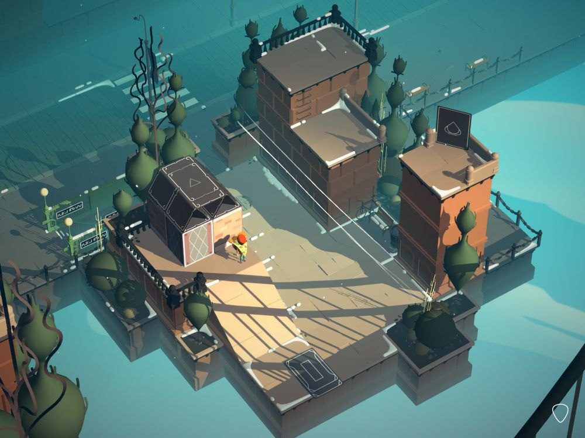
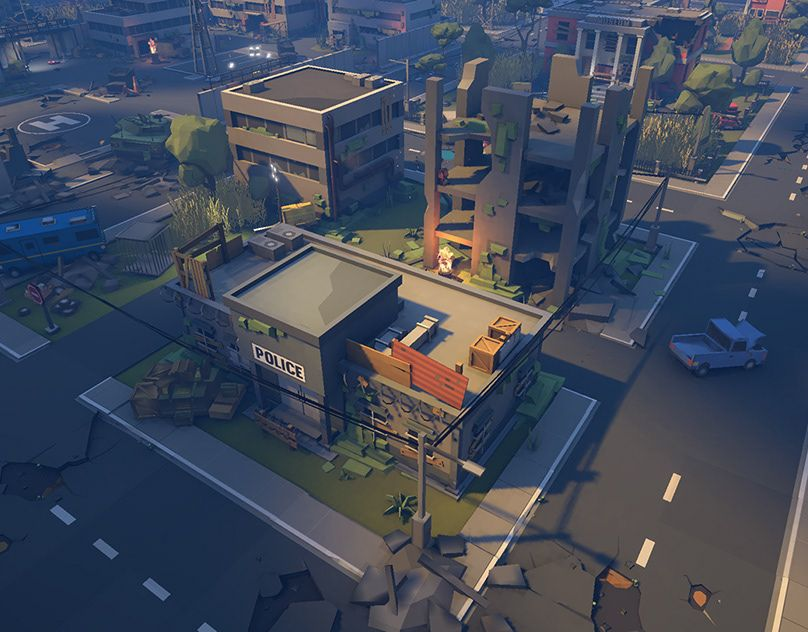
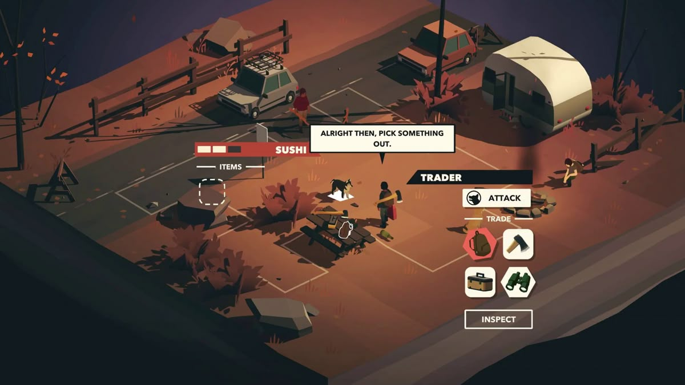

# ART DIRECTION 3D — ĐƯỜNG VỀ NHÀ
Phiên bản 1.0 · 21/10/2026 · Brief tạo model và animation cho Codex

## 0. Đọc trước khi bắt đầu

**Đây là guide và yêu cầu sản xuất, chưa phải lệnh tạo asset hoặc tích hợp vào game ngay.** Công việc cân bằng được tạm dừng theo chỉ thị mới của chủ dự án. Không sửa difficulty, QTE, kinh tế hoặc collider để phục vụ một model đẹp hơn.

Hai tài liệu đi cùng nhau:
1. File này quyết định hướng nghệ thuật, chất lượng, ngôn ngữ hình khối và hợp đồng model/animation.
2. [MODEL_ANIMATION_WORKLOAD.md](MODEL_ANIMATION_WORKLOAD.md) là danh mục công việc, biến thể, trạng thái và tiêu chí bàn giao.

**Thứ tự ưu tiên:** yêu cầu mới trực tiếp của chủ dự án → guide này về art/model/animation → workload đi kèm → design gameplay hiện hành → các ghi chú art cũ. Khi mâu thuẫn về visual, guide này thắng. Không dùng ưu tiên art để tự đổi luật chơi, số người, hitbox hoặc trạng thái simulation. Đặc biệt, hướng cũ “tối hơn, giảm saturation toàn cảnh, placeholder đơn giản” không còn là đích chất lượng art cuối. Hạn chế của một prototype cũ cũng không phải tiêu chuẩn chất lượng model mới.

Nhãn dùng trong bộ guide:
- **[D]**: bao phủ nội dung design game đã có.
- **[U]**: yêu cầu art/diễn xuất mới do chủ dự án nêu.
- **[R]**: đề xuất nghệ thuật bổ sung để tăng chất lượng; không tự biến thành mechanic.
- **[F]**: việc phối hợp dành cho phase ánh sáng/shader/VFX/UI sau; hiện chỉ chuẩn bị model, material ID, rig hoặc socket.

Phạm vi hiện tại: thiết kế và lập workload cho mesh, cụm cảnh, vật liệu cơ sở/phân vùng bề mặt, rig, clip animation, pose, biến thể hư hỏng và các điểm gắn. **Chưa làm UI, icon HUD, shader, lighting setup production, particle, post-processing, SFX hoặc VFX.** “Xe bốc cháy” cần model cháy/hư hỏng và vị trí phát lửa; ngọn lửa/khói thực do phase FX sau làm. Tài liệu được phép mô tả sự phối hợp để model không bị làm lại.

## 1. Tuyên ngôn nghệ thuật

**Một hành trình về nhà sống động, duyên dáng và đẹp mắt, đi qua một thế giới đang oằn mình vì mưa bão.**

Màu sắc vẫn có sức sống: thân xe sáng đẹp, áo mưa có cá tính, mảng cây và kiến trúc có màu riêng, vài góc sinh hoạt ấm áp. Sự buồn và khó khăn xuất hiện có chủ đích qua mái hiên trĩu nước, cánh cửa đóng vội, vệt ngập trên tường, hàng rào nghiêng, cây bị gió ép, vỉa hè trống và người đang cố che mưa. Không phủ xám mọi thứ, không biến thành thành phố tận thế, không trang trí mọi chỗ bằng đổ nát.

“Premium low-poly” phải đến từ:
- Silhouette được thiết kế, tỷ lệ có chủ ý và mặt phẳng bắt sáng đẹp.
- Hình lớn rõ, hình vừa giàu cá tính, chi tiết nhỏ đặt đúng điểm nhìn.
- Màu, chất liệu và độ cũ có nhịp; không random màu từng polygon.
- Xe và con người có thái độ, có quán tính và phản ứng thuyết phục.
- Cảnh quan là những cụm được bố cục, không phải rải đồ vật cho đầy.
- Nhìn đẹp bằng màu cơ sở và ánh sáng kiểm tra đơn giản trước; lighting/VFX sau nâng chất lượng chứ không cứu mesh sơ sài.

Cảm giác cần đồng thời có: **hấp dẫn — có tay nghề — đời thường — dí dỏm — mong manh trước mưa bão — còn hy vọng**.

## 2. Ba reference và cách chuyển thành ngôn ngữ riêng

Reference do chủ dự án cung cấp; ảnh là ví dụ visual, không phải chỉ thị gameplay hay danh mục cần sao chép. Chỉ phân tích từ những gì nhìn thấy, không suy tên game hoặc pipeline tạo ảnh.

### REF_01 — Nhịp sáng tối và kiến trúc có chủ đích

Lấy: các khối nhà lớn rõ; cụm cây có silhouette thanh; chi tiết mái/lan can tạo nhịp; mảng sáng ấm đối với vùng xa xanh lạnh; khoảng trống được giữ để mắt nghỉ. Mỗi cạnh và đồ vật đều đóng góp vào composition.

Chuyển vào game: cụm hiên/quán/sân nhỏ ở bên đường, cửa và lan can làm điểm neo, khoảng sân hoặc bãi cỏ tạo nhịp thở. Không sao chép tòa nhà hoặc biến đường endless thành sân chơi diorama cố định. Không bake bóng nắng dài lên texture vì phase lighting/mưa bão phải còn chủ động.

### REF_02 — Cụm môi trường nhiều lớp, kể chuyện bằng cấu trúc

Lấy: chiều sâu giữa đường–vỉa hè–nhà–cây; cảm giác đô thị có nhiều lớp; khối bê tông, mái, cửa sổ và đồ nghề có cấu tạo. Bố cục đa dạng mà vẫn đọc được đường.

Chuyển vào game: khu phố sau bão có biển hơi lệch, mái tôn, tầng nhà lùi sâu, bờ tường ngập và cây chống tạm. **Không lấy súng, bạo lực, cảnh sát nước ngoài, tận thế hoặc công trình tan hoang làm mặc định**; chúng không thuộc yêu cầu game. Nhà đang xây/đang sửa chỉ là một biến thể, không bao phủ toàn bộ đô thị.

### REF_03 — Màu thành mảng, prop có tính cách, con người giàu gesture

Lấy: màu đất ấm có chọn lọc, vật dụng chia thành nhóm rõ, cây/bụi được đơn giản hóa có duyên, nhân vật diễn đạt bằng tư thế. Đồ vật ít polygon nhưng không vô hồn.

Chuyển vào game: quầy ven đường, đồ sinh hoạt, trạm dừng và cụm nhân vật có cùng ngôn ngữ. Không lấy UI, combat, hexagon icon hay toàn bộ palette đỏ cam làm đích; giữ camera sau xe và cấu trúc đường hiện hành.

### Tổng hợp

Giữ độ sáng sủa và bố cục của REF_01, mật độ cấu trúc có kiểm soát của REF_02, khả năng kể chuyện bằng màu/gesture của REF_03. Kết quả phải có dấu ấn đường về nhà giữa mưa bão, không thành bản chép một trong ba ảnh.

## 3. Màu sắc và sắc thái cảm xúc

Bảng sau là **mẫu art để thử**, không là mã shader đã chốt:

| Vai trò | Màu mẫu | Cách dùng |
|---|---|---|
|Nền tối trung tính|Asphalt xanh #34454C|Mặt đường/đế cảnh, vẫn tách được bánh xe|
|Lạnh của cơn bão|Teal xám #547C82|Mảng xa, mái, bề mặt chịu mưa|
|Nước ngập|Xanh ngọc bùn #477C80|Phân biệt nước và nhựa đường bằng màu + ranh hình, không chỉ phản chiếu|
|Ánh ấm đời sống|Vàng mật ong #E6AD55|Màu vật liệu cửa/biển/đồ, điểm tựa thị giác; phát sáng thật để phase sau|
|Điểm nhấn xe|Cam san hô #D96A4A|Một lựa chọn hero, không tô mọi hazard cùng màu|
|Cây sống|Xanh lá #6E915C / #38685C|Nhiều lớp sáng tối, có mảng xanh tươi giữa bão|
|Sáng trung tính|Kem #E5D9B8|Mái hiên, viền xe, áo, vật liệu sáng|
|Sắc buồn tinh tế|Tím xám #737487|Góc khuất, bê tông lạnh, quần áo ướt|
|Chi tiết sâu|Mực #25323B|Kính, khe, lốp; tránh mọi vùng thành đen tuyệt đối|

Không dùng mọi màu trong một prefab. Một xe ưu tiên một màu thân chính, một phụ, một accent nhỏ; các nhóm lớn có chênh giá trị sáng tối trước chênh hue. Có màu tươi ở nơi người chơi cần nhìn, môi trường giữ nền kiểm soát. Tỷ lệ màu phụ thuộc cảnh, không áp một filter “desaturate” lên cả thế giới.

**Nuance quan trọng:**
- Cùng một mặt sơn có vùng cạnh sạch, mảng dưới dính bùn và vài dấu xước có câu chuyện; không phủ noise đều.
- Vệt nước tối chạy theo cấu trúc, dưới gờ và mép mái; không dán vết bẩn ngẫu nhiên.
- Mái/hiên và cây tạo chỗ trú; kiến trúc có cảm giác đang được con người sử dụng.
- Giữa chuỗi khó khăn vẫn có một chậu cây được che, chiếc ghế kéo vào hiên, ánh màu ấm của cửa tiệm.
- Sự dí dỏm đến từ tình huống và thái độ, không từ làm nạn nhân trông ngớ ngẩn hoặc biến người thành vật dùng một lần.
- Tránh đồng nhất tuổi, giới, màu da hoặc vóc dáng với vai “phiền phức”.

## 4. Ngôn ngữ hình khối và bề mặt

### Cấu trúc ba cấp

**Khối chính:** silhouette phải đọc được ở camera gameplay. Xe máy mảnh/nhẹ; mô tô có bình và động cơ mạnh; car4 gọn; car7 thân dài; ba gác có đầu kéo và thùng riêng; bus dài và nhịp cửa sổ; truck cabin + thùng; container đầu kéo + khối hàng có khớp.

**Khối vừa:** vòm bánh, mũi xe, cản, cửa, mái, trụ, thân cây, bậc hiên, quầy. Đây là phần tạo cá tính, cần ưu tiên hơn tem nhỏ hoặc đinh tán.

**Chi tiết nhỏ:** gương, tay nắm, dây chằng, mép biển, gân bình, túi áo, đèn. Chỉ giữ nơi có giá trị silhouette, material hoặc diễn xuất; bỏ chi tiết thành đốm ở xa.

### Hình học

- Bevel có chọn lọc ở cạnh bắt sáng, mép mui, vòm bánh, cản, đồ gỗ; không bevel cùng độ rộng mọi cạnh.
- Mặt phẳng lớn sạch, chuyển tiết diện có ý thức. Flat/smooth normal theo vật liệu: kính và sơn không giống đá chẻ.
- Không tessellate ngẫu nhiên để trông “low-poly”; không dùng nhiều tam giác nhỏ phá khối.
- Bánh không là một trụ đen thô: phải có vai lốp, mặt lăn, lòng bánh/moay-ơ vừa đủ đọc.
- Kính có khung và độ sâu giả/độ lõm vừa phải; không cần dựng đầy nội thất không nhìn thấy.
- Cây khác nhau về thân, nhánh chính, kiểu tán và trọng tâm; không chỉ một nón trên một trụ.
- Bụi/cỏ thành cụm có mép, lỗ thoáng và hướng phát triển; tránh thảm gai đồng nhất.
- Kiến trúc có bề dày mái, mép cửa, chân tường; không là hộp được dán ô vuông.
- Đồ hư có lực và nguyên nhân: cản bị ép về phía va, mâm lệch nhẹ, cửa/lá tôn cong; không gắn vài que ngẫu nhiên rồi gọi damaged.

### Vật liệu ở bước model

Chỉ tạo hoặc quy định các nhóm bề mặt cơ sở: sơn, kính, cao su, kim loại, nhựa, vải mưa, gỗ, bê tông, lá, đất, bùn. Tách material ID và vùng mask sạch/bẩn/cháy để phase shader sử dụng sau. Không bake ánh đèn, phản chiếu giả sáng chói hoặc bóng dài vào base color.

Nếu pipeline dùng vertex color, cần bảng màu nhất quán và vùng chọn được. Nếu dùng atlas, cần UV và texel density theo vai trò. Không tự chuyển stack hoặc thêm hệ shader để hoàn thiện bước model.

## 5. Xe người chơi phải là “hero asset”

Bốn xe trọng tâm phải được thiết kế như sản phẩm người chơi muốn sở hữu: xe máy, mô tô, car4, car7. Xe còn lại vẫn được làm trau chuốt; tính giải trí không đồng nghĩa làm qua loa.

Từ góc sau xe, ưu tiên thiết kế đuôi, đèn hậu, mui, vai thân và dáng tài xế. Một chiếc xe đẹp chỉ ở góc quảng cáo trước mũi nhưng vô vị khi chơi là chưa đạt. Cần bản vẽ/turntable front, side, rear, top và góc gameplay trước khi gọi hoàn tất.

Yêu cầu chung:
- Tỷ lệ và footprint giữ đúng loại xe hiện hành. Không phóng lớn bánh hoặc vỏ làm người chơi hiểu sai khoảng lách.
- Mỗi loại có chi tiết nhận diện riêng từ xa; palette sơn biến thể là phụ, không thay thiết kế khối.
- Bánh, tay lái/trục lái, phần treo/thân, đèn, chỗ người ngồi và bộ phận cần cử động phải tách pivot đúng.
- Lean/steer/force của simulation và chuyển động secondary của mesh tách cấp; không cộng góc nghiêng hai lần.
- Car7 phải hiện được quét đuôi nhẹ; tải/bus quét đầu; container player có đầu kéo, khớp và rơ-moóc. Container traffic giữ một cụm theo gameplay hiện hành.
- Cabin player kín: tài xế ở trong. Hành khách có đầu/thân trên ở cửa sổ theo design. Traffic không tự hiện đoàn người thò cửa sổ.
- Người không bị kéo to theo thân xe; đủ số khách logic phải có bố trí hình ảnh hợp lệ, kể cả bus và quá tải. Không cắt bớt khách trong model rồi báo đã khớp roster.
- Dùng mount và pose người phù hợp từng xe: ngồi sau xe máy không giống đứng/ngồi ở thùng ba gác hay nhoài cửa sổ bus.
- Bộ “clean / used / damaged / destroyed” có chuyển tiếp có lý; stopped do hết xăng không tự thành wreck hoặc bốc cháy.

## 6. Con người, tính cách và diễn xuất

Tỷ lệ stylized, đầu và tay đủ đọc gesture ở góc nhìn xa nhưng không chibi cực đoan. Người phải có cổ/vai/hông/khớp gối rõ, trọng lượng đứng trên chân. Trang phục có nếp lớn và cấu tạo, không là một màu trên các capsule.

Cần đa dạng tuổi, giới, chiều cao, vóc dáng, màu da, tóc, áo mưa, mũ, túi và nghề nghiệp. Thiết kế khác nhau ở silhouette và tư thế, không chỉ đổi màu áo. Một skeleton family có thể dùng chung nhưng cần retarget/hiệu chỉnh cho tỷ lệ khác, đặc biệt trẻ em và người cao tuổi.

**Thang diễn xuất:**
1. Tư thế toàn thân: nghiêng tránh gió, gồng tay lái, che đầu, ngồi co chân.
2. Gesture vừa: vẫy, chỉ, xua tay, phủi quần, giơ hai tay, lắc đầu.
3. Biểu cảm đầu/mặt đơn giản: quay nhìn, gật, cau mày, thở ra; không làm đầy facial rig nếu ở gameplay không đọc được.

Chuỗi va chạm: mất thăng bằng → văng/đáp → nằm/ngồi có nhịp → chống tay đứng dậy → phủi đồ/nhìn xe → chạy về hoặc ở lại. Cú ngã phải theo hướng vận tốc và phía va; không một clip “ngã chung” luôn quay mặt đúng camera.

Khách gọi xe có 2–3 sắc thái: vẫy dứt khoát, nhón nhìn từ dưới mái hiên, một tay giữ túi/áo mưa. Người từ chối sau tai nạn lắc đầu/xua tay/quay đi; người tức giận giơ tay/phàn nàn bằng cơ thể, không cần thêm thoại hoặc UI. Player có diễn xuất gồng cua, giật mình, lấy lại tay lái, nhẹ nhõm; không biến họ thành tượng ngồi.

Công an chỉ vào xe đang tới, ra hiệu dừng; khi bị vượt có thể quay nhìn và giơ tay bực. Dân phòng có dáng và nhịp khác, không là cùng nhân vật đổi màu. Chuối vô hiệu nhóm phải có pose dễ hiểu, không tiếp tục phát gesture “đang bắt” sau khi bị vô hiệu.

Diễn xuất trang trí **không kéo dài miễn nhiễm, đổi thời gian bắt, thêm hành vi đuổi theo, hoặc chặn input**. Clip phải khớp nhịp simulation hoặc co giãn đúng đoạn; gesture tức giận sau khi đứng dậy là lớp phụ nếu đủ thời gian hiển thị.

## 7. Môi trường: đẹp theo cụm và có đời sống

Cốt lõi là đường về nhà có sắc thái đời thường Việt Nam/Đông Nam Á, không mô phỏng chính xác một địa điểm. Cụm nhà ống, quán hiên, mái tôn, xe hai bánh, mương/canal, đồng ruộng và cây nhiệt đới gợi bối cảnh. Tránh trộn ngẫu nhiên biệt thự châu Âu, sa mạc và thành phố Mỹ trong một đoạn.

Mỗi vùng cần:
- Khối nền/địa hình, midground và landmark xa.
- Cụm chi tiết gần đường có scale người.
- Dải chuyển tiếp để không “đổi biome” bằng vạch thẳng.
- Trạng thái sau mưa/bão vừa phải, có chỗ vẫn sạch và ấm.
- Các module góc trong/góc ngoài/junction/đầu-kết để rẽ không lộ mặt sau rỗng.
- Ít nhất một khoảng trống có chủ đích; không nhồi props vào mọi mét.

Các bộ bắt buộc theo workload: khu nhà thưa, đô thị, công viên, đường hàng cây/bụi, đồi/vách đá, đồng ruộng, bãi cỏ, hồ, sông/kênh và ven biển. Các vùng bổ sung từ yêu cầu mới là art set, không tự có luật ma sát, đường tắt, sinh vật hoặc nhiệm vụ riêng.

Dấu bão ưu tiên: bậc thềm ngập một phần, chân tường có vệt nước, vật nhẹ được chằng, tán cây lệch, cành gãy chọn lọc, biển đóng cửa, mái bạt căng. Không dùng hàng loạt nhà sập/nạn nhân/đống rác để thay cho cái nhìn nghệ thuật.

**Road dressing không đồng nghĩa hazard:** một cành trang trí hoặc thùng bên lề không được nhìn y hệt vật gây damage nếu không có collider. Prop nền phải có vùng placement và cờ decorative rõ, không thêm vật cản vô hình.

## 8. Composition và camera — chỉ là hướng phối hợp

Ảnh tham chiếu là góc cao/isometric, còn game có camera sau xe và khung9:16. Giữ sau xe, có thể nâng góc để đọc được mái/đuôi và mặt đường; không đổi sang góc chéo cố định khiến rẽ và traffic khó đọc.

Ứng viên để thử sau khi có model mẫu: pitch khoảng48–58° nhìn xuống, phối cảnh vừa phải; FOV khoảng35–45° chỉ là điểm bắt đầu để đánh giá. Không áp các số này mà bỏ kiểm đường nhìn/camera hiện tại.

- Hành lang giữa và vùng trước xe là khoảng đọc gameplay; props cao dồn về rìa.
- Cụm gần khung có thể đậm, cụm giữa đường rõ, mảng xa đơn giản/lạnh hơn về chất liệu cơ sở.
- Dáng xe player được neo ổn định trong vùng dưới–giữa; không hy sinh chiều dài container hoặc che khoảng cảnh báo để làm ảnh đẹp.
- Để landmark lệch tâm, dẫn mắt theo hướng đường; không dựng một cột ở đúng chỗ QTE/xe nguồn thả đồ.
- Tại cua giữ continuity của nhánh cũ, viền bờ và các cụm trang trí; không xoay cả thế giới theo camera.
- Không thêm camera shake, zoom khi va, motion blur hay occlusion fade trong bước model. Chỉ ghi nhu cầu/hook cho phase phù hợp.
- Khi cần camera thích nghi chiều dài xe, không làm đường nhìn tới hazard ngắn hơn yêu cầu warning hiện hành.

Ảnh diorama đẹp đứng một mình chưa đủ. Mẫu phải đọc tốt khi xe chạy nhanh, ở cả hai mép đường, giao lộ, nước hai làn và cảnh đông NPC.

## 9. Hợp đồng model và animation cho bên triển khai

### Hệ tọa độ và tỷ lệ

Một đơn vị model tương ứng1 m; local +Y là up, +Z là forward ở đầu ra chuẩn của art package. Nếu runtime đang dùng forward khác, đặt một adapter ở root, ghi rõ phép đổi; không tự xoay từng asset theo cảm giác. Blender nếu được dùng có thể author Z-up, nhưng đầu ra và preview phải thống nhất. Đây là quy ước đề xuất cho bàn giao, cần đối chiếu loader hiện hữu trước triển khai.

Root ở mặt đất tại mốc điều hướng của xe/actor; modelRoot và visualBody không là cùng một pivot bắt buộc. Lưu riêng:
- root/logic anchor;
- body center, axles, wheel centers;
- bus/truck rear pivot; car7 front-biased pivot;
- tractor, hitch, trailer và rear axle;
- seat/window mounts, handholds và cửa ra/vào;
- collision proxy để đối chiếu, không tự thay collider game.

Kích thước tham chiếu theo catalog cũ đang có: xe máy0,896×2 m; mô tô0,96×2,2 m; car4 1,86×4,2 m; car7 2,08×4,8 m; ba gác1,76×3,2 m; bus2,72×10 m; truck2,72×7 m; container2,88×15 m. **Phải kiểm definition mới nhất khi bắt đầu**, các số này không phải lệnh ghi đè catalog. Gương/ăng-ten có thể là chi tiết mềm nhưng không được che mơ hồ silhouette va chạm.

### Cấu trúc và quyền điều khiển

Đề xuất phân cấp:
logicRoot → force/steeringPose → suspensionVisual → bodyMesh/rig → các phần phụ.

Simulation quyết định quỹ đạo, lực, chuyển trạng thái, thời điểm va và kết ván. Animation chỉ diễn tả, không tự dời root theo root motion rồi cộng thêm chuyển động simulation. Bánh quay theo quãng đường/tốc độ thực, bánh trước theo góc lái, suspension chỉ dao động hình ảnh trong giới hạn. Không chạy wheel loop đều khi xe đã dừng.

Một state chỉ có một chủ thể điều khiển:
- Transform root/khớp xe: runtime.
- Pose seated/gesture/clip người: animation.
- Material variant hư hỏng: trạng thái hiện hữu.
- Particle, ánh sáng thực, sound: phase sau.
- Asset ID/rider ID không đổi vì animation, đổi skin hoặc LOD.

Clip có thể sample theo normalized phase của simulation; loop idle/wave có phase seeded riêng không tiêu RNG gameplay. Đoạn văng/ngã không được tự thêm0,5 s vì đẹp; scale hoặc tách clip theo thời gian hiện hành. Ngắt đúng khi actor bị retire, pause, reset, đổi xe, chết hoặc secret.

### Metadata tối thiểu

Mỗi asset family phải có: ID, nhãnD/U/R, source yêu cầu, version, bounding box, pivot/axes, material slots, clip list, socket list, state variants, LOD, số triangle/material/bone thực, vai player/traffic/decor, gameplay collision role, dependencies và status review. ID ổn định, tên có nghĩa, không dùng random GUID làm tên clip người đọc cần chỉnh.

Gợi ý tên: veh_car4_player_A, veh_car4_traffic_A, chr_passenger_senior_F_A, haz_water_long_2 lane, env_rural_house_A. Clip: idle_wait, hail_vehicle_A, impact_air, grounded, stand_up, refuse_board_A, gesture_angry_A. Không thay ID gameplay bằng ID model.

### Socket chuẩn bị cho phase sau

Đặt socket/locator cho headlamp/tail/brake/indicator, exhaust, engine_smoke/fire, wheel_spray, contact_spark, cargo_drop, hand/banana_release, phone, seat/window_exit, ground_contact. Ghi hướng và không gian của từng socket. Không tạo emitter hoặc đèn thật trong lượt model chỉ để chứng minh socket tồn tại.

### Pipeline

Design hiện có dùng Three.js và model tạo bằng code. Mặc định bám pipeline đó: module geometry/material palette/rig có tổ chức, dùng mặt cắt và khối được thiết kế, không hàng trăm primitive vô định. **Không tự đổi stack hoặc bắt buộc mua asset/plugin.**

Nếu dự án sau này chấp nhận Blender/GLB, giữ cùng hợp đồng axes/pivot/ID/socket/LOD; bàn giao source edit được và đầu ra dùng được. Đây là lựa chọn authoring, không là yêu cầu phải chuyển pipeline. Chưa tạo Blender file hoặc gọi công cụ tạo model trong lượt soạn guide.

## 10. Chất lượng và ngân sách đề xuất

Low-poly không đo bằng “ít polygon nhất”. Dùng triangle nơi cải thiện silhouette, mặt bắt sáng, biến dạng khớp; giảm ở mặt khuất.

Mốc khởi đầu để benchmark, **không phải giới hạn đã đo trên game**:
- Hero xe hai bánh/ba gác: khoảng2–5k triangle.
- Hero car4/car7: khoảng4–9k.
- Bus/truck: khoảng5–10k; container player toàn bộ khoảng8–14k.
- Nhân vật gần: khoảng0,9–1,8k; tạo LOD giảm trước khi nhân24 khách.
- Cây gần: khoảng0,2–0,8k; nhà/cụm nhà module khoảng1–4k tùy silhouette.
- Giảm mesh/material riêng lẻ; dùng chung palette/atlas, instancing cho props tĩnh khi phase tích hợp cho phép.

Tối thiểu có LOD gần/vừa/xa hoặc giải pháp tương đương. LOD không mất tín hiệu hướng xe, loại hazard hoặc số người mà gameplay cần đọc. Mesh far không mang rig đầy đủ vô ích. Người trên bus có thể dùng pose giản lược xa nhưng roster và bố trí vẫn đúng.

Không tuyên bố60 FPS hoặc chốt budget tổng trước benchmark: cảnh kiểm phải có8 loại traffic, bus đầy khách, container, gió/đồ rơi và cua; ghi thiết bị, pixel ratio, draw calls, triangles, animation CPU, frame P95 và thời gian tải. Đây là yêu cầu nghiệm thu phase tích hợp, không phải việc chạy trong bước viết guide.

## 11. Những chi tiết tạo “wow” đáng làm [R]

| Ưu tiên | Ý tưởng | Giá trị | Giới hạn |
|---|---|---|---|
|Cao|Đuôi hero xe có nhịp đèn/kim loại/sơn rất đẹp ở góc chơi|Người chơi nhìn xuyên suốt ván|Không phải thêm đènFX ngay|
|Cao|Áo mưa, dây chằng, túi và tán cây có secondary motion nhẹ|Cho cảm giác cả thế giới chịu cùng một cơn gió|Deform hình ảnh, không thêm collider/force|
|Cao|Cụm cửa tiệm ấm giữa dải nhà đóng cửa và nước ngập|Khoảnh khắc hy vọng và mốc định hướng|Không tự thêm shop hoặc bonus|
|Cao|Phản ứng khác nhau của khách sau va: ôm túi, sửa mũ, xua tay|Tính người và hài tình huống|Không đổi tỷ lệ quay lại|
|Vừa|Vệt nước theo cao độ, bậc thềm/lan can và đá bị ngập một phần|Bão có lịch sử, không chỉ một plane xanh|Water shader làm sau|
|Vừa|Cụm landmark: bến sông, đình/quán nhỏ, cầu nhìn xa, chòi ruộng, hàng đèn quán|Mỗi vùng có ký ức riêng|Không thêm đường cầu/đích chơi khi chưa có design|
|Vừa|Cửa kính có tài xế quay nhìn và xe traffic giật mình khi near-miss|Thế giới phản hồi player|Near-miss chỉ trigger cosmetic khi runtime hỗ trợ, không thêm điểm|
|Sau|Đổi lớp ướt/độ phản chiếu và ánh ấm rất tiết chế|Hoàn thiện premium|Để phase shader/lighting, không làm bây giờ|

Tăng chất lượng bằng2–3ý tưởng được làm đến nơi đến chốn trước, không thêm20 gimmick làm cảnh ồn.

## 12. Mẫu duyệt và tiêu chuẩn hoàn tất

Trước khi sản xuất hàng loạt, bên triển khai phải làm một **mẫu chuẩn đại diện** trong phase tạo asset được chủ dự án cho bắt đầu: hero car4, xe máy, một NPC, một cụm nhà/hiên, một cây, một đoạn ngập/ổ gà. Guide hiện tại chỉ quy định mẫu đó, chưa tạo nó.

Bộ góc duyệt: neutral turntable; góc gameplay9:16; cảnh xám để đọc khối; kiểm với nền sáng/tối; pose và damaged; crowded view; vật thể ở đúng scale và footprint. Đèn kiểm tra đơn giản được dùng ở lượt sản xuất để thấy mesh, không coi là phase lighting production đã xong.

Rubric đích premium: chấm từng mục0–10, ghi evidence và việc sửa:
1. Silhouette và tỷ lệ.
2. Khối vừa/bevel/normal có chủ đích.
3. Màu và phân vai vật liệu.
4. Nuance/câu chuyện mưa bão.
5. Diễn xuất/trọng lượng/cá tính.
6. Nhất quán giữa xe–người–cảnh.
7. Đọc được khi chơi và đúng geometry/collider.
8. Hiệu quả model/rig/LOD và khả năng chỉnh sửa.

Mẫu chuẩn không gọi đạt nếu có mục dưới8/10; không lấy trung bình che điểm yếu. Chưa có evidence thì ghi chưa đánh giá, không tự nhận “high premium” bằng mô tả. Người làm có thể tự review nhưng không giả có art director độc lập. Chủ dự án duyệt mẫu trước khi nhân toàn catalog.

**Không được bàn giao:** xe hộp kéo dài đổi màu; người hình que/capsule; cây cone-cylinder lặp; model đẹp ở close-up nhưng chìm ở gameplay; nhiều noise để giả chi tiết; animation sai lực; ảnh render đẹp che thiếu mesh mặt sau; asset không có pivot/clip/socket/LOD/manifest; file guide bị diễn giải thành lệnh sửa balance hoặc làm UI/FX.

## 13. Nguồn và giới hạn xác minh

- Nguồn yêu cầu chính: chỉ thị art mới và ba ảnh chủ dự án gửi ngày21/10/2026.
- Đã đối chiếu bộ design ở checkout game cục bộ: GAME_DESIGN.md, DESIGN_ITEMS_HAZARDS.md, DESIGN_MOVING_EVENTS_TRAFFIC.md, ROADMAP.md, TECH_SPEC.md và hướng vật lý đã biết. Checkout đang có thay đổi P8 chưa hoàn tất; không dùng số cân bằng đang biến động làm thông số art.
- Revision remote gần nhất được xác minh trong lượt này vẫn là b0c226f trên codex/car7-front-pivot; tài liệu cục bộ có bổ sung P8 đang làm. File workload gắn nguồn theo hạng mục để kiểm lại với HEAD khi bắt đầu sản xuất.
- Không tạo model, clip, texture production, đèn, shader hoặc FX; không sửa repo game. Ảnh reference được chép nguyên file vào references để gói guide có thể chuyển sang workspace khác; không chỉnh sửa ảnh.

