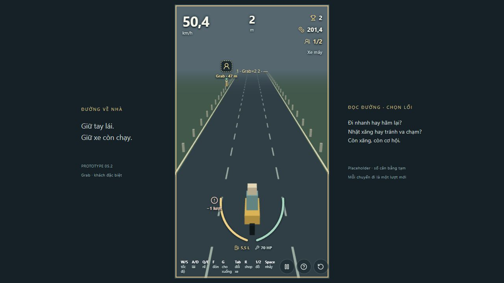
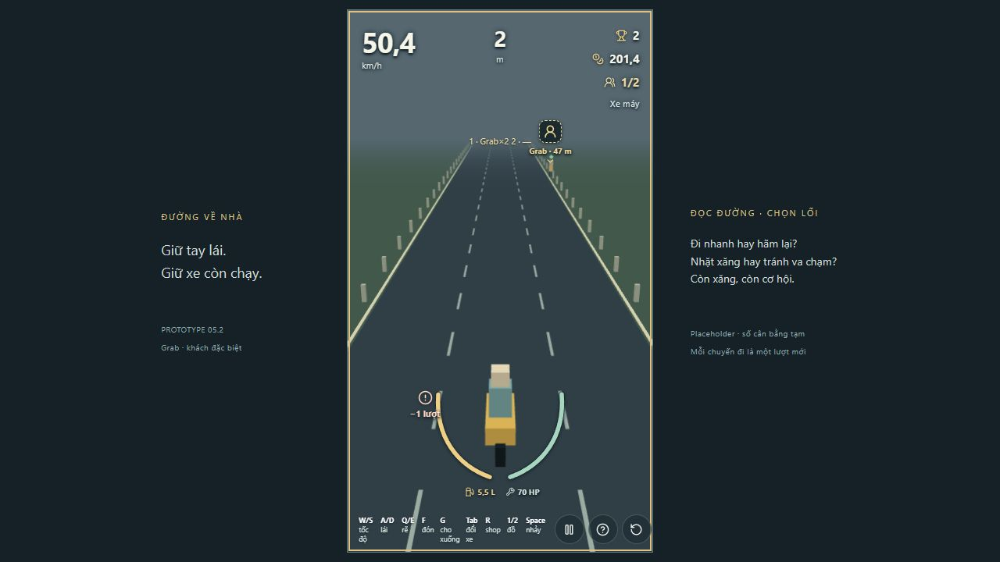

# Grab — khách chờ ngẫu nhiên ở hai ven đường

18/10/2026, base local `bc0670b`, branch `codex/grab-roadside-spawn`, config `p5-2-grab-roadside-2`. Codex tự review từ simulation/test và input browser thực.

## Thay đổi

Chỉ thử hai mép ngoài mặt đường. Bên ưu tiên chọn seeded từ run/branch/sequence, không sắp theo bên gần xe. Bên ưu tiên bị chặn thì thử bên còn lại; không còn fallback ở giữa hoặc trong lane. RNG hazard không bị tiêu/reroll. Giữ vị trí dọc, an toàn, cooldown, lượt, giá/thưởng và luật F/G/crash.

Tâm NPC = ±(nửa bề rộng đường + nửa bề rộng collider NPC), hiện ±5,15 m trên đường rộng 9,6 m. Kiểm tra khả năng đón và hazard tại vị trí xe có thể tấp vào trong biên đường; không dùng tâm NPC ngoài đường làm tâm footprint xe. Cùng cách tính áp dụng cho pocket tránh hazard mới sinh. Không tăng tầm F để hợp thức hóa NPC không tiếp cận được.

## Check trên code cuối — Windows / Node 24.19.0 / pnpm lockfile

| Command | Exit | Kết quả |
|---|---|---|
| `pnpm lint` | 0 | Pass |
| `pnpm typecheck` | 0 | Pass |
| `pnpm test` | 0 | 126 test / 22 file pass |
| `pnpm build` | 0 | Pass; cảnh báo chunk JS 568,42 kB còn tồn tại |
| `pnpm simulate` | 0 | 39 test / 4 file pass |

Test mới/đổi: NPC nằm ngoài mặt đường; đón bằng F ở tọa độ xe hợp lệ cho 80 tổ hợp seed/8 loại xe, cả container; 100 seed cho cả hai bờ và không phụ thuộc bên xe đang đứng; sequence khác có hai bờ; bên bị chặn chỉ fallback sang bờ kia; bảo vệ footprint đón trên mặt đường khi sinh hazard tương lai, không chỉ bảo vệ điểm NPC ngoài lề. DOM test đã bổ sung giữ A/D để thực sự tấp lề trước khi F, không giữ assertion đón từ giữa đường. Simulation Grab 30 seed/20 s hai lần vẫn finite, reproducible và không âm lượt/nhân roster. Bộ income không đổi theo thay đổi vị trí này; chưa gọi economy đã cân.

## Manual in-app browser

1. `?scenario=grab&seed=17`: bắt đầu → 1; còn hai lượt, cue “Khách Grab · trái”. Khách nằm ngoài lề trái. Pause, tiếp tục giữ A 2,5 s rồi F: tại khoảng 38 m HUD 2/2, vẫn hai lượt.
2. `?scenario=grab&seed=3`: cùng thao tác, cue “Khách Grab · phải”. Giữ D 2,5 s rồi F: HUD 2/2, vẫn hai lượt.

Ảnh hỗ trợ xác nhận vị trí, không thay bằng chứng input; hai thao tác đón đã chạy riêng. CHƯA KIỂM TRA THỦ CÔNG lại cả 8 xe hoặc mọi nhánh/failure/restart trong lượt này; có suite hồi quy, test footprint và input. Không đo/chấm visual art, không đổi layout theo yêu cầu giữ UX/UI cho phase riêng.

## Tự review gameplay / UX chức năng

Người chơi nay phải tấp lề thay vì gọi khách ngay trước bánh xe ở giữa đường. Dự kiến tăng quyết định đổi hướng và chú ý traffic; cần đánh giá tiếp ở ván thường, nhất là xe dài khi tấp lề ngược chiều. Chưa đổi độ khó hoặc số thưởng để bù. Cue trái/phải và F hoạt động trong manual; hoàn thiện marker/bố cục vẫn thuộc P UI.

## Bàn giao Git

Branch riêng từ base local; repo chưa có remote/main cập nhật để fetch, chưa push/PR/CI, chưa merge. Commit local báo trong bàn giao. Các thay đổi `sources/` và phần không liên quan không bị sửa; giá và thông số economy giữ nguyên. Chờ review/chơi thử của chủ dự án cho revision này.
