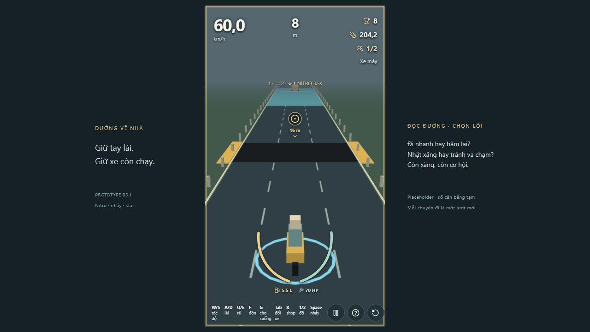
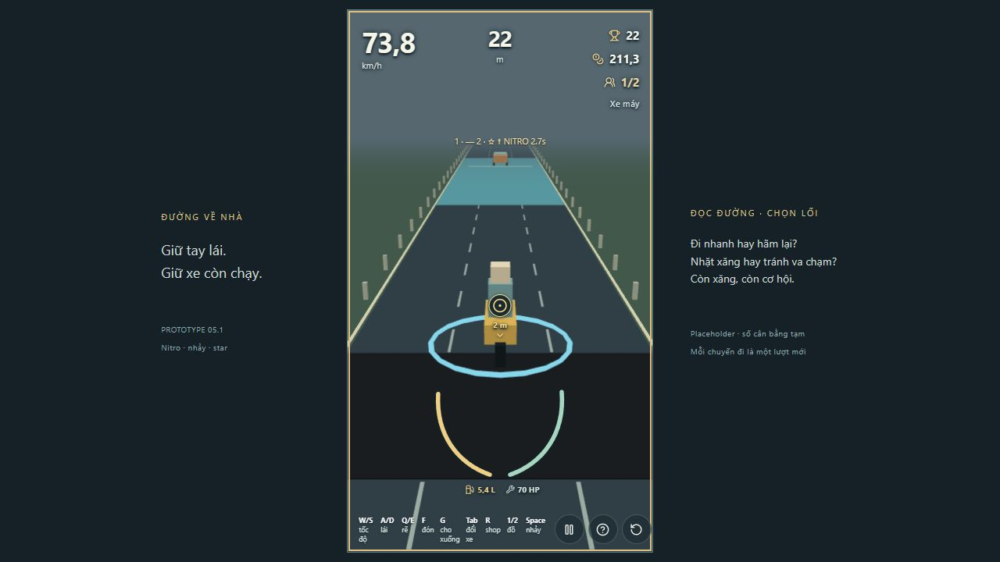

# P5.1 — tách nitro boost và Space nhảy

18/10/2026. Base local `aacfa14`, branch `codex/nitro-space-jump`, config `p5-1-space-jump-2`. Codex tự review từ test, simulation và in-app browser; không có reviewer độc lập.

## Thay đổi theo chủ dự án

Phím ô 1/2 chỉ kích hoạt boost (giữ số thử 4 s). Space mới bắt đầu nhảy khi boost còn, xe có lực kéo và đang trên mặt đường. Giữ Space không tự nhảy lại; bấm trên không không reset quỹ đạo. Sau đáp có thể bấm lại nếu nitro vẫn còn. Nhảy không tiêu thêm món hoặc kéo dài boost. Cú nhảy đang thực hiện hoàn tất bình thường nếu boost hết giữa không trung; sau đó không nhảy tiếp khi thiếu nitro. Pause/ngã/kết ván/hết xăng/coasting không nhận nhảy. Star riêng không cho nhảy.

Chỉ cập nhật hướng dẫn input trong intro/Help/shop/footer; không sửa layout/art, giá, thời lượng hoặc star. UX/UI hoàn chỉnh và review visual để phase tương ứng theo chủ dự án. Docs đã cập nhật; mô tả tự nhảy trong báo cáo P5.1 đầu giữ như lịch sử.

## Gate thật — Windows / Node 24.19.0 / pnpm lockfile

| Command | Exit | Kết quả |
|---|---|---|
| `pnpm lint` | 0 | Pass |
| `pnpm typecheck` | 0 | Pass |
| `pnpm test` | 0 | 112 test / 20 file pass |
| `pnpm build` | 0 | Pass; cảnh báo chunk 561,54 kB vẫn còn |
| `pnpm simulate` | 0 | 26 test / 3 file pass |

Test mới chứng minh boost không tự nâng xe, Space riêng mới tạo flight, không gia hạn timer/tiêu thêm món, không nhảy khi pause/star-only/nitro hết, không nhảy kép trên không, nhảy lại sau đáp và đáp an toàn khi timer boost hết. DOM integration dùng input thật, kiểm tra độ cao từ state truyền vào renderer; key repeat Space không bật nhảy. Các test collision/clearance/FPS trước đây đã đổi để gửi lệnh nhảy riêng, không bỏ kiểm tra.

Một assertion ban đầu thấy độ cao tại đúng lúc đáp là khoảng 1,3e-14 m do sai số số thực. Hàm độ cao đã dùng cùng epsilon với guard đáp đất để trả 0 ổn định ở biên, không giảm độ chính xác test để che lỗi.

Simulation mới: 20 seed 1–20 chạy 30 s hai lần, nitro tick 180 và Space tick 210, star tick 600; finite/reproducible, distance 407–472 m, 20/20 còn running. Baseline 30 seed/chiến thuật không dùng món giữ kết quả cruise/W/S: đủ tiền 30/30, trung vị 85,72/60,18/149,78 s và chết 9/13/2. Đây là kiểm tra ổn định/regression, không phải chứng minh độ khó hay economy đã cân bằng.

## Manual — in-app browser, scenario items, seed 17

1. Bắt đầu, nhấn 1, giữ W 300 ms: tốc độ khoảng 60 km/h, xe vẫn sát mặt đường; ô 1 trống, ô 2 còn star, timer boost khoảng 3,5 s. Esc pause giữ timer.
2. Tiếp tục, nhấn Space rồi giữ W 500 ms: xe lên cao, tốc độ khoảng 74 km/h; timer boost còn khoảng 2,7 s, ô 2 không bị tiêu. Esc vẫn pause được. Đây là thao tác thật; ảnh chỉ hỗ trợ xác nhận hình ảnh.

CHƯA KIỂM TRA THỦ CÔNG lại toàn bộ failure/restart/xe dài/tàu ở lượt này. Restart/failure/FPS/footprint có suite hồi quy; tàu chưa triển khai và giữ gate P6. Không chấm visual hoặc tuyên bố hiệu năng 60 FPS từ ảnh.

## Tự review gameplay và UX chức năng

Điểm thực tế: boost và thời điểm cất cánh đã tách được qua input lẫn simulation; người chơi có thể giữ nitro để chọn thời điểm nhảy. ĐỀ XUẤT đánh giá sau: đo số lần nhảy/món và tỷ lệ đáp bị va, vì cho bấm lại sau đáp khi còn boost có thể mạnh hơn bản một cú tự nhảy. Chưa sửa cooldown/giá/thời lượng. UX chỉ xác minh phím Space, key repeat và nội dung hướng dẫn; phần layout/visual giữ lại phase riêng, không mở rộng scope.

## Git

Branch riêng từ bản P5.1 local. Repo vẫn chưa cấu hình remote/main cập nhật, nên chưa fetch/push/PR/CI; không merge. Gate và manual ở trên không thay thế review con người cho revision mới. Commit local được báo trong bàn giao.
