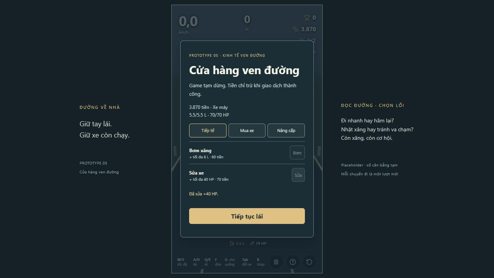

# P5 — tiếp tế tại chỗ và phân kỳ vật phẩm/chướng ngại

Ngày 18/10/2026. Revision kiểm tra: working tree trên `7eb449a`, branch `feature/p5-controls-and-garage`, config `p5-services-only-3`. Bao gồm feedback garage/input đang làm từ lượt trước; không reset hay bỏ thay đổi đó. Đây là tự review của Codex từ test/simulation và thao tác browser thực, không có reviewer độc lập.

## Thay đổi

- Bỏ gói xăng và bộ sửa mang theo ở UI, transaction, config, state và input. Lệnh item từ UI cũ bị từ chối không charge/mutate. Shop vẫn có tiếp tế trực tiếp, mua xe, nâng cấp. Phím R shop; C bỏ. Phím 1/2 chưa có tác dụng tới khi có kho vật phẩm mới ở P5.1.
- Giữ feedback garage: đủ tám loại xe, loại đang sở hữu không mua lặp; chọn xe dự phòng để nâng cấp mà không equip/refill.
- Không thay giá, mức tiếp tế, pickup tài nguyên trên đường hay difficulty ở lượt này. Thông số tiếp tế cũ vẫn TẠM.
- [Đặc tả mới](DESIGN_ITEMS_HAZARDS.md) phân kỳ P5.1 nitro/star, P5.2 Grab, P6 nền + chuối, P6.1 vật cản/chuyển lane, P6.2 lực môi trường, P6.3 vật rơi. Những tính năng đó mới ở design/roadmap, chưa có trong game. Tuning P8 trước UI/art P9, SFX/VFX P10 cuối cùng.

## Gate tự động — Windows, Node 24.19.0, pnpm theo lockfile

| Command | Exit | Kết quả |
|---|---|---|
| `pnpm lint` | 0 | Pass |
| `pnpm typecheck` | 0 | Pass |
| `pnpm test` | 0 | 98 test / 18 file pass |
| `pnpm build` | 0 | Pass; cảnh báo chunk JS khoảng 555 kB, chưa coi là đo hiệu năng |
| `pnpm simulate` | 0 | 13 test / 2 file pass |
| `git diff --check` | 0 | Không lỗi whitespace; Git có cảnh báo chuyển LF/CRLF |

Test hành vi gồm command gói mang theo cũ không thể hồi/trừ tiền; service clamp/đầy/thiếu tiền/stale sequence; DOM thật R mở shop, C không mở, 1/2 không hồi HP, shop không còn tab mua món, tiếp tế hồi ngay; restart khôi phục ván. Kiểm tra lại catalog, xe thứ ba và nâng cấp dự phòng trong suite chung.

Simulation chạy config trên: movement 20 phút mỗi seed 17/42/20261017 finite, reproducible. Survival/economy 30 seed mỗi chiến thuật: cruise đủ tiền 30/30, trung vị 85,72 s, chết 9 lượt; W 30/30, 60,18 s, chết 13 lượt; S 30/30, 149,78 s, chết 2 lượt. Bộ đo mua xe thật riêng: cruise 29/30 mua được, W 28/30; các lượt lỡ shop là seed 115 (cruise), 102/126 (W). Đủ tiền không đồng nghĩa đã mua được xe. Đây là bot/script hữu hạn, không đo mức vui hay khẳng định curve đã đạt.

## Manual chức năng và UX — in-app browser, seed 17, scenario shop

1. Bắt đầu từ fixture 4.000 tiền, 1 L / 30 HP. Nhấn R mở shop ở đúng vị trí. Hiện ba mục Tiếp tế/Mua xe/Nâng cấp, không có mua vật phẩm. Game tạm dừng khi mua.
2. Bấm Bơm: ví 3.940, xăng 5,5 L; Bơm khóa. Bấm Sửa: ví 3.870, HP 70; cả hai nút khóa. Số hồi thực đọc được trong phản hồi. [Ảnh hiện trạng](evidence/p5-services/01-service-only.png).
3. Esc rời shop, nhấn 1/2 rồi Esc pause: không phát sinh hồi tài nguyên/món mang theo. Chơi lại từ pause: về màn bắt đầu 4.000 tiền, 1 L / 30 HP của fixture, không giữ giao dịch cũ.

Không coi ảnh là bằng chứng timing/input: các hành vi trên được thao tác riêng. CHƯA KIỂM TRA THỦ CÔNG trong lượt này: thất bại, va chạm ở max upgrade, thao tác nâng cấp dự phòng trên browser, tất cả vật phẩm/hazard mới (chưa triển khai). Mua/nâng cấp/input tổng quát có test tự động, không thay thế manual còn thiếu. Theo lựa chọn trước của chủ dự án, không làm lượt đánh bóng/chấm visual art ở prototype này.

## Tự review game design và UX

**Dữ kiện:** bỏ gói cứu nguy không làm đổi các bot baseline vốn không dùng món; chưa có bằng chứng về tác động tới người chơi quen mang gói. Shop chặn mua tài nguyên đầy và hiển thị đúng lượng hồi thực; luồng tiếp tế không cần chọn ô/dùng sau.

**Nhận định/đề xuất chưa áp dụng:** việc không mang gói có thể tăng áp lực phải tới shop, nhưng nhặt xăng miễn phí vẫn có thể làm nhẹ áp lực này. Lần sau so sánh thời gian xăng thấp, số shop ghé, lý do chết và tiền ròng giữa các đoạn distance; chưa giảm tiếp tế hay tăng damage ở đây. Nitro/star có thể làm game dễ hơn; cần test riêng trước phối hợp director. Grab cần đo tiền tăng thêm thực so với giá/lượt để không tự nuôi economy vô hạn.

**UX chức năng:** không còn hướng dẫn dùng gói cũ; phản hồi tài nguyên và trạng thái disabled rõ trên ảnh bước 2. Cần kiểm chứng cue thời lượng/nhảy/star và số lượt Grab ở P mới trước khi làm visual hoàn chỉnh. Chưa kết luận accessibility toàn diện hoặc cảm giác lái từ ảnh.

## Git và bàn giao

Repo không có remote cấu hình/main cập nhật để làm base theo quy trình. Working tree có thay đổi P5 chưa commit từ trước lượt này; giữ nguyên và bổ sung phần yêu cầu mới trên branch hiện hữu. Chưa commit/push/tạo PR/CI, chưa merge; không tuyên bố đã đạt gate merge hoặc đã có phê duyệt revision. Diff và tài liệu hiện tại là kết quả local có thể review. Không thử lại thao tác push đã bị từ chối trước đó. Chủ dự án chưa duyệt cân bằng/diễn giải star với terminal tàu; các điểm đó giữ nhãn ĐỀ XUẤT cho P sau.
