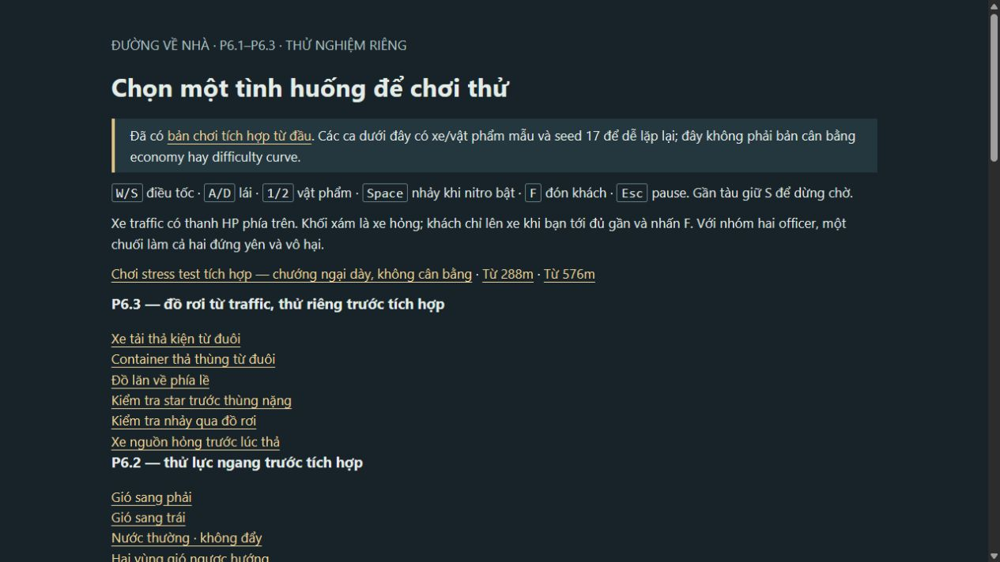
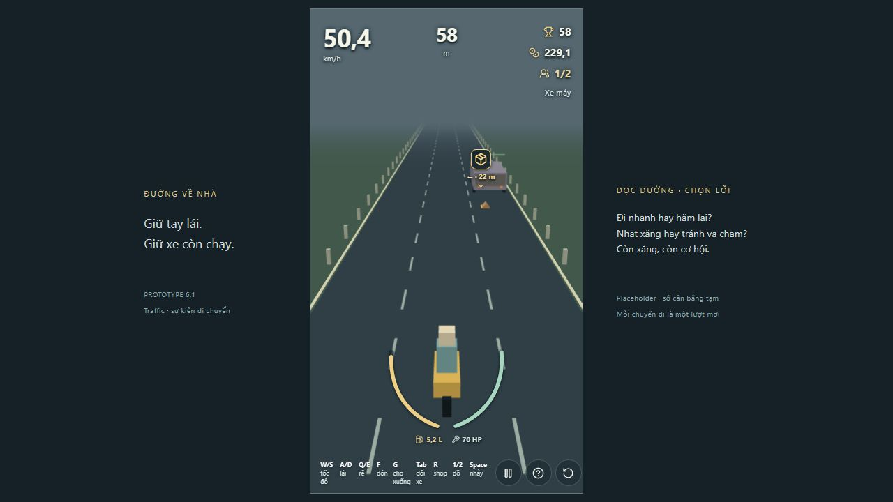
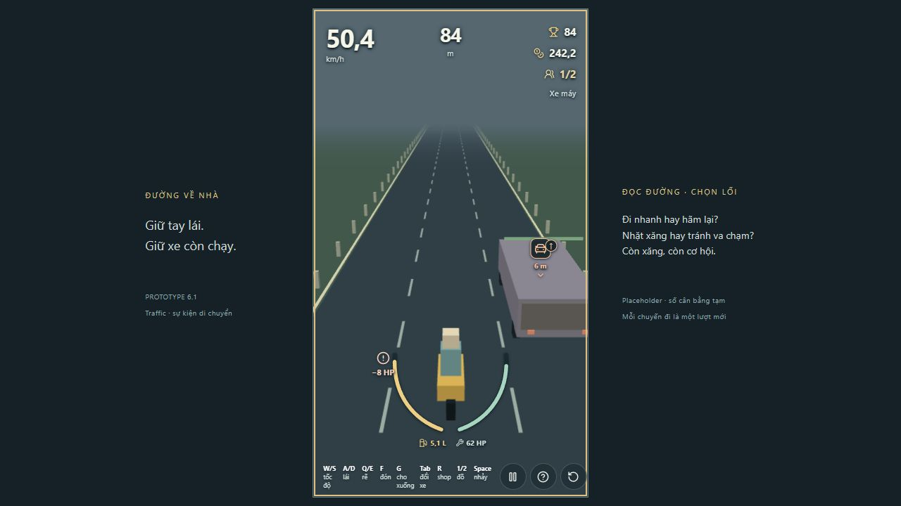
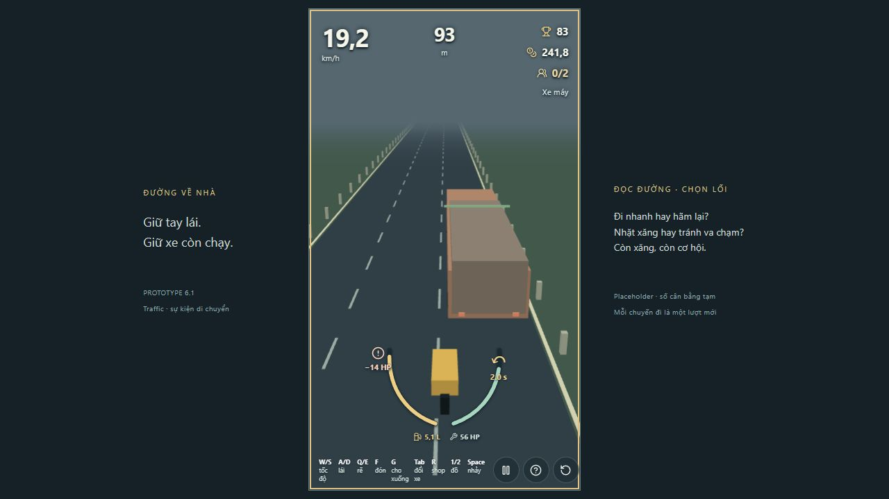

# P6.3 — báo cáo thử đồ rơi từ traffic (18/10/2026)

## Phạm vi và quyết định

Revision chuẩn bị trên branch `codex/p63-traffic-cargo-scenarios`, base local `253719d`. Sáu ca ở `/p61.html#cargo`, version `p63-cargo-1`; chưa sinh đồ trong ván thường/stress và chưa tích hợp gió P6.2. Theo feedback mới, chỉ xe tải/container còn chạy **cùng chiều** có thể rơi đồ. Vật xuất hiện ở trục **sau đuôi** xe, trượt lùi, rồi lăn lệch trái/phải bằng hash của seed nhánh + ID xe. Hướng không báo trước khi thả; sau khi thả mới hiện cue theo vật. Số thử TẠM: tồn tại 12 s, tối đa 4 vật hiện diện, kiện −8 HP, thùng −14 HP và gây ngã. Không đổi economy/difficulty director. Chồng gió với nước, ổ gà, vật cố định hoãn theo yêu cầu chủ dự án.

## Simulation và kiểm tra logic

- `pnpm test tests/traffic-cargo.test.ts --maxWorkers=1 --minWorkers=1`: exit 0; 9 ca gồm một lần/xe nguồn, từ chối xe ngược chiều/dừng/hỏng/ngoài màn, giới hạn số vật, hết hạn, seed và hướng lăn, quỹ đạo nảy mép đường, swept collision, star/nhảy, nhánh rẽ, khung hình 30/60/144 và né bằng A/D.
- 30 seed ở cruise không điều khiển: **9 va kiện, 21 tránh tự nhiên**; không có trạng thái NaN, không nhân vật, mỗi ca tối đa 1 vật. Đây là dữ liệu từ simulation, không đo mức vui hay phản xạ con người. Seed 17 đi thẳng trúng kiện; A sớm giữ 70 HP.
- Giao thông thường/stress vẫn không có nguồn P6.3. Archive stress P6.1 `archives/p61-stress-581c4df/source.zip` còn SHA256 `0f6014282dd1582bc10e5445c2bb1cc5b0fee8f4a93fe088c09e53373808a31c`.

## Manual trong ChatGPT in-app browser

Seed 17, viewport 1265×712. Mở menu, bấm ca thử, bắt đầu ván, xem cue nguồn, vật rơi và va chạm, thử restart và kết ván do hết xăng. Ca kiện đi thẳng giảm 70→62 HP đúng một lần và vẫn chạy; ca container giảm 70→56 HP, tài xế văng ra, xe trôi rồi phục hồi. Link menu P6.3 mở được; sau khi đặt P6.3 lên trước P6.2, ca thử mới hiện ngay ở phần đầu trang. Star, nitro/Space, xe nguồn hỏng và các seed khác được kiểm tra bằng simulation; chưa chơi thủ công hết mọi ca. Chưa quan sát đủ cảm giác lái từ người chơi thật.

### Ảnh flow và audit UX tự đánh giá

1. [Chọn ca P6.3](evidence/p63-scenario-hub.png): **ổn**. Sáu link có tên mô tả tình huống; bản thường và thử riêng tách rõ. Rủi ro thấp: danh sách link vẫn đơn giản, phong cách trang sẽ xử lý ở P9.

   

2. [Đồ vừa rơi sau xe tải](evidence/p63-cargo-from-rear.png): **đọc được nhờ cue**. Xe nguồn nằm cùng chiều bên phải; vật bắt đầu ngay sau đuôi, icon gắn lên vật và báo khoảng cách. Rủi ro trung bình: hình kiện primitive hơi nhỏ so với đường, cần người chơi đánh giá khả năng nhìn lúc W/tốc độ cao. Không thể suy ra timing công bằng chỉ từ ảnh.

   

3. [Kiện chạm xe](evidence/p63-cargo-impact.png): **phản hồi rõ**. `−8 HP` hiện cạnh xe và vòng HP còn 62; không có bảng log che đường. Cần quan sát thêm độ đọc popup trên màn nhỏ/độ tương phản khác.

   

4. [Thùng nặng gây ngã](evidence/p63-barrel-crash.png): **hậu quả thấy rõ**. `−14 HP`, HUD 56 HP, khách/tài xế rời xe và countdown quay lại. Ảnh không chứng minh animation/timing phục hồi; simulation kiểm tra trạng thái, người chơi cần nhận xét cảm giác.

   

Ảnh chụp trong lượt review này và mở lại file để xác nhận đúng trạng thái. Chưa đo bằng screen reader, zoom hay thiết bị cảm ứng; ảnh không chứng minh khả năng truy cập đầy đủ.

## Review game designer (Codex tự đánh giá)

**Dữ kiện:** warning trên xe có trước drop; vật chỉ từ đuôi xe cùng chiều; 9/30 seed đi cruise không né bị trúng kiện; A sớm né được seed 17; thùng gây một lần sát thương rồi ngã. **Nhận định:** hướng lăn chưa biết trước tạo một quyết định lái sau khi vật rơi, hợp mục tiêu tập trung hơn chướng ngại cố định. 9/30 hit cruise là mức thử được, chưa phải mục tiêu cân bằng. Đồ nhỏ có thể khó nhận khi phối hợp giao thông dày; khi tích hợp nên đo thời gian từ cue vật đến va chạm ở W, tỷ lệ né thành công và số lần không còn hành lang an toàn theo kích cỡ xe. ĐỀ XUẤT sau feedback: giữ một cảnh báo xe nguồn rõ, thêm một tín hiệu chuyển động/silhouette đơn giản cho vật trước khi tăng tần suất; hỏi chủ dự án về cảm giác né trước khi điều chỉnh damage, density hay quỹ đạo.

## Gate và bàn giao

`pnpm lint` exit 0; `pnpm typecheck` exit 0; `pnpm build` exit 0 (Vite cảnh báo bundle >500 kB). `pnpm test --maxWorkers=1 --minWorkers=1 --testTimeout=30000` exit 0: 202/202 tests, 28 files. `pnpm simulate --maxWorkers=1 --minWorkers=1 --testTimeout=30000` exit 0: 115/115 tests, 10 files. Lần đầu chạy test và simulate **đồng thời** với timeout mặc định 15 s làm bài playtest P5 quá hạn dù in đủ kết quả; chạy lần lượt với giới hạn 30 s cho gate hoàn tất. Không giảm assertion hay bỏ suite.

Chưa có remote Git nên không fetch/fast-forward remote main, push, tạo PR hoặc theo dõi CI được. Feature branch bắt đầu từ commit local P6.2 đã bàn giao; không merge. Review/phê duyệt của chủ dự án cho bản P6.3 hiện tại đang chờ.
