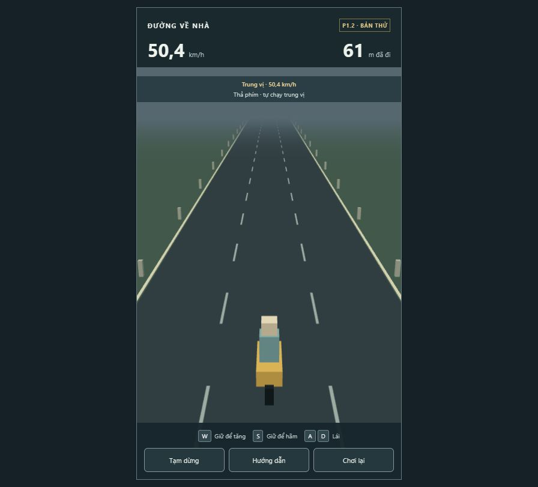
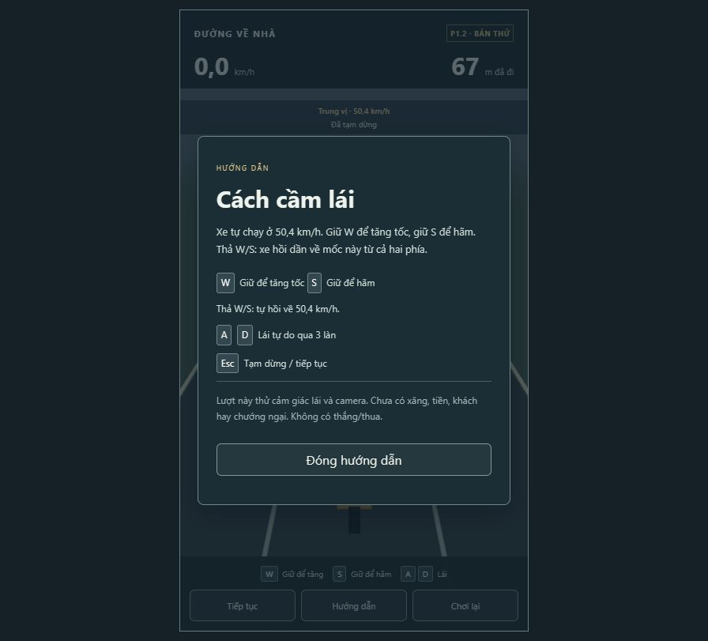
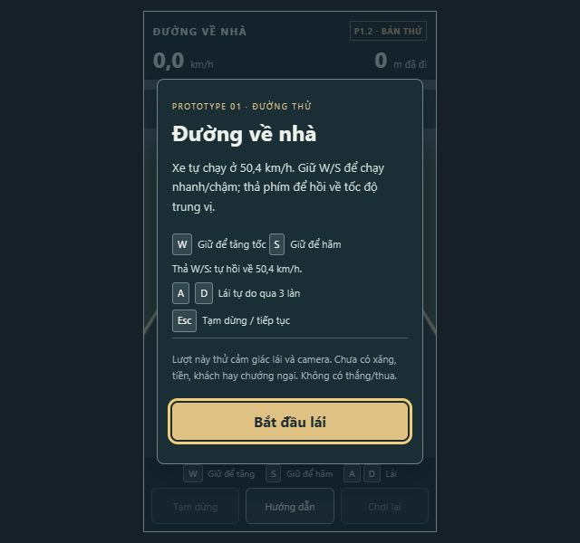

# P1.2 — áp dụng tốc độ trung vị

17/10/2026, UTC+7. Codex tự review từ simulation, kiểm tra DOM và thao tác trong in-app browser; không có reviewer độc lập.

## Hiện vật và phạm vi

Revision code: `24707ee`, branch `feature/prototype-1-driving`, config `p1.2`. Production cuối: `index-nRXHPXen.js`, CSS `index-D7Azhtyn.css`. Commit sau revision này chỉ bổ sung báo cáo/log/evidence. Bản chạy: http://127.0.0.1:5173/ . Đã nạp P1.2 ở màn bắt đầu cho chủ dự án.

P1 vẫn chỉ có xe máy và đường thử. Đã áp dụng số tạm trong design: min/cruise/max **8/14/20 m/s** (28,8/50,4/72 km/h), gia tốc W 5 m/s², hãm S 10 m/s²; tự tăng về cruise 3 m/s², tự giảm về cruise 4 m/s². Start/restart ở cruise; W/S giữ nhanh/chậm, W+S ưu tiên S, chỉ giữ A/D vẫn hồi tốc. Hội tụ có giới hạn bước và epsilon kỹ thuật, không overshoot/dao động. Pause không hồi tốc; resume giữ vận tốc lúc pause và bỏ input cũ.

HUD có mốc cruise và trạng thái giữ W/S/đang hồi/đã ổn định. Tốc độ có một chữ số thập phân để mốc 50,4 khớp vận tốc hiển thị. Help và onboarding không còn nói thả W giữ nguyên tốc độ. Đã rút gọn một dòng nhắc lặp để vừa cửa sổ thấp, tái sử dụng bộ định dạng số thay vì tạo mỗi frame. Sửa sai số làm tròn hiển thị tại mốc quãng đường nguyên; distance simulation không bị làm tròn.

Giảm cruise theo khách, các xe khác, economy, xăng/coasting, nitro và QTE chưa có trong P1, chưa gọi hoàn thành các integration tương lai. Không có art/SFX hoàn chỉnh mới. Không tự bắt đầu P2.

## Các vòng thực nghiệm và review sau mỗi vòng

| Vòng | Bằng chứng/kết quả | Game-design self-review | UI/UX self-review |
|---|---|---|---|
| R1, config p1.2, bản trước commit | Input simulation 3 seed chạy xong, nhưng test tổng fail 3 case: kỳ vọng phanh sai thời lượng trong test, epsilon hội tụ, floor hiển thị 13,999... thành 13. Chưa gọi pass. | Luật target đúng ý định; sửa kỳ vọng phanh theo 10 m/s² và sai số kỹ thuật, không chỉnh số cân bằng để chiều test. Seed results đã ổn định nhưng chưa chứng minh gameplay mới đạt. | Cần tốc độ hiển thị thập phân và nhắc giữ/thả rõ; lỗi hiển thị mốc distance cần sửa. |
| R2, config p1.2, JS `index-_6HpX-1p.js` | 12/12 test pass. Browser W rồi thả: thấy 69,4 → 50,4 km/h; S rồi thả: 30,6 → 50,4. Giữ D khi hồi vẫn lái và về cruise. Pause/Help giữ cùng 923 m qua hai quan sát. | Không phát hiện overshoot hoặc vi phạm bounds trong mẫu; không đổi rates. Cần chủ dự án nhận xét độ nhanh/chậm của hồi tốc. Đường trống chưa đánh giá áp lực QTE/hazard. | Mốc và trạng thái đọc được, Help đúng. Dòng giải thích đang lặp dài; rút ngắn và thử cửa sổ 640×600. Ảnh 01–03 ở vòng này. |
| R3, revision `24707ee`, JS `index-nRXHPXen.js` | Chạy lại 4 gate, 12/12 tests; kiểm tra onboarding 640×600, restart về 0 và chạy lại 50,4, Help cuối. FPS sample/console bên dưới. | Input logic/số không đổi so R2, deterministic results giữ nguyên. Đủ cho chơi thử cơ chế P1.2; chưa khóa balance. | Dòng nhắc ngắn hơn, nút start còn thấy/nhấn được ở 640×600. Ảnh 04–06 từ build cuối. Không phát hiện blocker trong các luồng đã thử. |

Các sửa sau R1/R2 là lỗi kỹ thuật/hướng dẫn, không phải thay đổi balance lớn. Các lần simulation lặp dùng cùng kịch bản, không phải playtest người dùng độc lập. Chủ dự án đã yêu cầu áp dụng design này; chưa có feedback về cảm giác các số tạm.

## Gate tự động và simulation cuối

Windows NT 10.0.22621, Node 24.19.0, pnpm 11.25.0. Không đo thêm cấu hình GPU/CPU đầy đủ; không ngoại suy hiệu năng máy khác.

| Gate | Command | Exit | Kết quả |
|---|---|---:|---|
| Lint | `pnpm lint` | 0 | Pass |
| Typecheck | `pnpm typecheck` | 0 | Pass, strict |
| Test | `pnpm test` | 0 | 12/12, 2 files |
| Production | `pnpm build` | 0 | Pass |

Log thật trong [checks-p1-2/](checks-p1-2/). Check chạy trên code được commit `24707ee`; commit không thay code sau check. Diff đã rà scope/whitespace và tìm credential patterns trong src/tests; không phát hiện secret trong phạm vi rà.

- 120 s không input: 1.680 m, giống nhau ở render 30/60/144 Hz; không dùng số frame/camera để cộng distance.
- Kịch bản hỗn hợp W → thả → S → thả + D có toàn State bằng nhau ở 30/60/144 Hz.
- Max 20 → cruise 14 mất 1,5 s, đi 25,5 m; min 8 → cruise 14 mất 2 s, đi 22 m. Kiểm tra đơn điệu/không overshoot ở các tốc độ sát mốc và giữ tại target 10 s.
- Giữ W/S đạt và giữ giới hạn; nhấn lại W/S ngắt quá trình hồi ngay. A/D không ngăn hồi. Config target 9/14/19 được thử bằng cùng controller, config/rate không hợp lệ bị từ chối.
- Ready/pause giữ nguyên cả speed/distance/ticks ở tốc độ 8 và 20; UI test kiểm tra release, blur khi giữ W, pause/help/resume, trạng thái HUD, focus trap/Esc và 10 restart. Restart dùng cùng một renderer.
- Input simulation 20 phút/seed, đổi input mỗi 0,25 s, fixed step 60 Hz; seed 42 chạy lặp lại toàn State bằng nhau. Không phải world-spawn hoặc economy simulation.

| Seed | Tick | Distance cuối | Vi phạm finite/speed/distance/biên |
|---|---:|---:|---|
| 17 | 72.000 | 15.099,529 m | 0 |
| 42 | 72.000 | 15.149,215 m | 0 |
| 20261017 | 72.000 | 15.091,953 m | 0 |

## Manual, hiệu năng và UI/UX audit

Trình duyệt: ChatGPT in-app browser, localhost production build. Đã thực hiện phím/click để thử hồi từ hai phía và lái ngang; ảnh chỉ bổ sung bằng chứng về UI. HUD có thể cập nhật sau một frame khi click pause/restart; xác nhận bằng snapshot kế tiếp, không coi snapshot chuyển tiếp là trạng thái simulation cuối.

1. **Start — đạt phạm vi P1.2:** giải thích giữ W/S và thả hồi về mốc. [01](evidence-p1-2/01-start.png) là trước rút ngắn câu; [05](evidence-p1-2/05-small-window.png) là bản cuối 640×600, nút start nhìn thấy và nhấn được.
2. **Lái/hồi — đạt các kịch bản đã thử:** [02](evidence-p1-2/02-cruise-after-w.png), [03](evidence-p1-2/03-steer-return.png); bản cuối ở [06](evidence-p1-2/06-final-driving.png). Mốc/state không che xe; camera vẫn thấy xe khi lái tới mép phải. Không kết luận timing/fairness từ ảnh.
3. **Pause/Help/restart — đạt mẫu:** pause/Help không tăng distance; Help nói rõ hồi từ cả hai phía, [04](evidence-p1-2/04-help.png). Restart về 0, start lại thấy 50,4 km/h. Có test xóa input cũ, pause không hồi vận tốc; chưa có bài chơi hazard/failure trong P1.
4. **Resize — đạt mẫu 640×600:** [05](evidence-p1-2/05-small-window.png); mốc tốc độ/CTA còn đọc được. Chưa kiểm tra mọi zoom/viewport hoặc screen reader; không tuyên bố WCAG compliance.

Mẫu performance cuối: 1.320 frame đã đo, cửa sổ 600 frame cuối **60,003 FPS**, p95 **16,90 ms**, CPU submit render trung bình **0,473 ms**. Đây không phải GPU timing hay chứng nhận mọi máy. Console log error/warn do browser tool trả về: rỗng. Chưa kiểm tra thủ công Alt+Tab/tab nền trên trình duyệt desktop thông thường; IAB không mô phỏng đầy đủ visibility như tab browser. Blur/reset input được kiểm tra trong DOM test. Các giới hạn này không bị suy thành pass từ build.

## Review game design, economy và bước tiếp

**Dữ kiện:** tốc độ tự chạy cơ sở tăng từ 8 lên 14 m/s theo design mới. 120 s thả phím đi xa hơn 75% so baseline cũ; mô phỏng input hỗn hợp cũng thay đổi distance. Distance thực vẫn là nguồn cho score/money/fuel tương lai; chưa cộng tiền/điểm hay tài nguyên trong P1.

**Nhận định:** luật mới tạo nhu cầu giữ phím để duy trì tốc độ cao/thấp, nhưng chưa có hazards nên chưa kết luận tăng niềm vui hoặc công bằng. Số 14 và rates 3/4 vẫn cần chủ dự án thử. Không tự chỉnh thêm tốc độ/difficulty/economy để tăng áp lực.

**Economy:** giữ mục tiêu cơ hội mua ô tô đầu tiên 3–5 phút. Số thu nhập cũ vẫn chưa đạt nếu không khách/chi phí (30 km ở 14 m/s khoảng 35,7 phút); P1.2 không khẳng định đã giải bài toán này. Khi thêm kinh tế/khách cần mô phỏng tiền ròng/phút dưới chiến thuật cruise/W/S và các tải, trước khi đề xuất đổi giá/thu nhập lớn.

**UI/UX nhận định:** mốc cố định và trạng thái hồi giúp phân biệt hành vi chủ ý với phím bị kẹt. Font trạng thái nhỏ ở cửa sổ thấp cần feedback người chơi; thông tin số tốc độ chính vẫn lớn. Chưa thêm polish/art/animation hoàn chỉnh. Hệ thống khách sau này phải cập nhật mốc hiệu dụng ngay và chuyển tốc độ êm, không dùng mốc xe rỗng gây hiểu nhầm.

**Chờ nhận xét:** hồi về mốc có quá nhanh/chậm, giữ W/S phối hợp A/D có thoải mái, và camera/HUD có dễ đọc hay không. Nếu cần thay rates/mốc lớn, trình đề xuất kèm test trước khi áp dụng. Chưa bắt đầu P2.

## Bàn giao review

Tiếp tục cùng feature P1 theo feedback, không tạo feature phụ thuộc trên main chưa merge. Repo vẫn không có remote/main từ xa để fetch hoặc cập nhật base; dùng fallback local/patch, không giả vờ đã tạo PR. Branch/commit code và kết quả thật ở trên; không push, chưa PR, chưa CI remote; đang chờ review con người, **chưa merge**. Các prototype/hệ thống tương lai chưa được đánh dấu hoàn thành.
