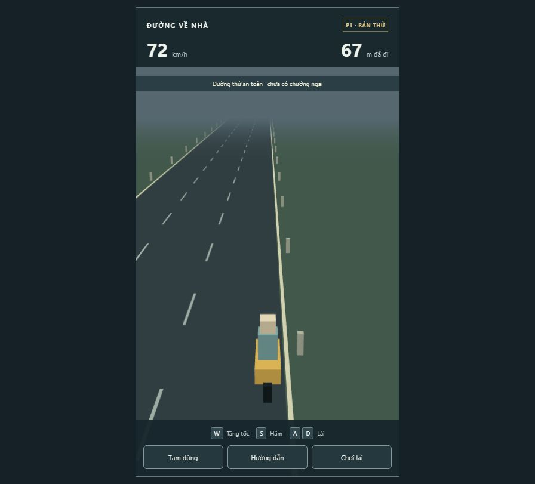
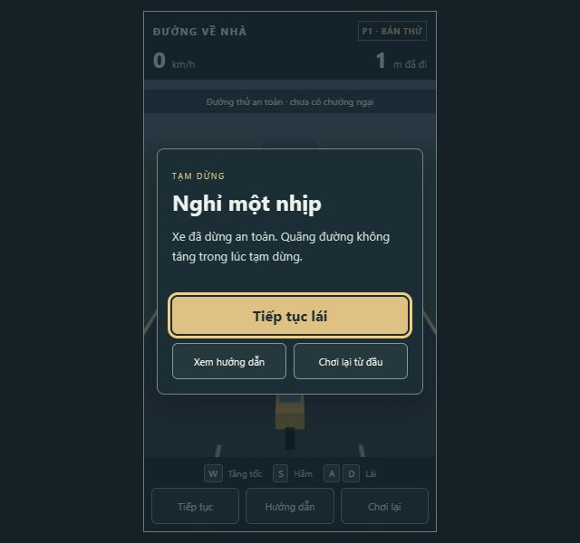
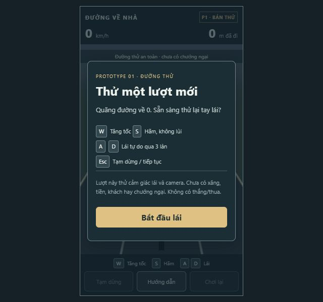

# Prototype 1 — bản thử và tự review

Ngày: 17/10/2026 (UTC+7). Người thực hiện/review: Codex, **tự đánh giá**, không có reviewer độc lập.

## Hiện vật

- Branch: `feature/prototype-1-driving`.
- Revision code đã kiểm tra: `5b3ec91`.
- Config: `p1.1`; production JS: `index-CsQXXHv8.js`.
- Bản chạy trên máy hiện tại: http://127.0.0.1:5173/ (server cần đang chạy).
- Source và hướng dẫn: README.md. Các prototype sau mở rộng cùng codebase này.
- Repo mới, main chỉ có empty baseline `f0daf77`; không có remote để fetch/fast-forward hoặc tạo PR. Đây là bàn giao local theo nhánh fallback trong AGENTS.md. Chưa push, chưa PR, chưa chạy CI từ xa, chưa merge. Commit automation dùng tên Codex, không dùng danh tính chủ dự án.

## Phạm vi và kết luận duyệt

Đã có xe máy bằng primitive, đường 3 lane, lái ngang liên tục, tự chạy 8 m/s, W tăng tới 20 m/s, S hãm không lùi, camera sau xe, HUD tốc độ/quãng đường, pause, Help, restart, khung 9:16. Không có art/SFX hoàn chỉnh.

**Đủ để chủ dự án chơi thử P1.** Không phát hiện lỗi chặn trong các kịch bản đã kiểm tra sau sửa camera. Chưa có căn cứ tuyên bố sạch mọi bug, đạt 60 FPS trên mọi máy, economy đã cân bằng hoặc game cuối đã vui. Duyệt cảm giác lái vẫn chờ người chơi thật. Chưa có thắng/thua trong phạm vi P1 nên kiểm tra thất bại là N/A; phải bổ sung P2.

## Kiểm tra cuối trên revision code

Windows NT 10.0.22621, Node 24.19.0, pnpm 11.25.0. CPU identifier đọc được: Intel64 Family 6 Model 167 Stepping 1, GenuineIntel. Không đọc được tên CPU/GPU đầy đủ do quyền hệ thống; không suy ra cấu hình tham chiếu đạt hiệu năng chung.

| Gate | Command | Exit | Kết quả |
|---|---|---:|---|
| Lint | `pnpm lint` | 0 | Pass |
| Typecheck | `pnpm typecheck` | 0 | Pass, strict |
| Tests | `pnpm test` | 0 | 8/8, 2 files |
| Production | `pnpm build` | 0 | Pass |

Output thật được lưu trong [checks/](checks/). Workflow CI đã chuẩn bị, chưa chạy trên remote. Production bundle khoảng 482 kB JS / 123 kB gzip; không có tải asset bên ngoài trong gameplay.

Lần đầu install bị chặn postinstall esbuild theo mặc định package manager; đã cho phép riêng esbuild trong workspace config và install lại pass. Dev prebundler gặp lỗi đọc thư mục ancestor do sandbox; dùng native config loader của Vite và browser ESM của Three, không mở rộng quyền. Dev server sau sửa chạy, request `/src/main.ts` trả HTTP 200. Lần check đầu có lỗi type cấu hình literal và timeout test harness; đã sửa kiểu config, gom các vi phạm trong loop trước assert (vẫn kiểm tra mọi tick), không giảm invariant hay nâng timeout để né lỗi.

## Các vòng simulation/playtest và review sau vòng

| Vòng | Dữ liệu/thực nghiệm | Game-design self-review | UI/UX self-review và xử lý |
|---|---|---|---|
| R1, JS `index-YJ4sw-Wp.js` | Simulation ban đầu chạy xong nhưng test harness timeout; chưa gọi pass. Browser: bắt đầu, W, D. | Không đổi số cân bằng; loop input random ban đầu dùng low bits quá thiên lệch nên chưa đại diện. Sửa harness sang high bits và giữ input 0,25 s để tăng độ hữu ích. Đường trống chưa đánh giá difficulty/niềm vui. | Phát hiện xe bị cắt ở mép phải: blocker đọc hình/điều khiển. Không cho qua bản này; sửa camera bám toàn bộ ngang. Ảnh 02 ghi lỗi, không dùng làm bằng chứng đạt. |
| R2, JS `index-XrGgirqy.js` | Simulation đã pass; browser W đạt 72 km/h, D tới mép, A đổi hướng, S về 29 km/h; pause/Help/restart. | Giữ 8–20 m/s và tự chạy; tăng tốc 2,4 s, hãm 1,2 s là baseline thử chứ chưa khóa balance. Không có hazard nên chưa kết luận phản ứng né công bằng. | Camera không còn cắt xe (03/04). Pause không cộng distance, Help mở lại được. Menu pause còn thiếu đường tới Help/restart bằng bàn phím; ưu tiên sửa trước bàn giao. |
| R3, revision `5b3ec91`, JS `index-CsQXXHv8.js` | 8/8 tests; mô phỏng nhiều FPS và seed; UI DOM test giữ/thả phím, blur, pause, Help, Tab/Esc, 10 restart; browser kiểm tra menu mới và resize 640×600. | Các invariant quãng đường/tốc độ giữ nguyên. Không tự áp dụng thay đổi economy. Đủ nền kỹ thuật để tiếp tục thiết kế P2, còn chờ feedback về feel. | Pause có Help/Chơi lại, focus trap theo các nút đang hiện; hướng dẫn không lặp dài trong pause. Resize giữ canvas vừa màn hình. Không phát hiện blocker trong luồng cuối đã thử. |

Sau mỗi vòng, thay đổi đã áp dụng chỉ là sửa lỗi camera, harness, focus/UI và môi trường chạy; không đổi cơ chế đã chốt hoặc cân bằng lớn. Các lần chạy lại kiểm chứng cùng scenario/config, không được diễn giải thành các lượt playtest người dùng độc lập.

## Kết quả simulation cuối

- Fixed update 60 Hz. Ở render 30/60/144 Hz, auto-run 120 s đều đạt 960 m (sai lệch < 1e-6 m).
- Tăng 8 → 20 m/s trong 2,4 s: 33,6 m. Hãm 20 → 8 trong 1,2 s: 16,8 m. Giữ S không lùi; W+S ưu tiên phanh; thả W giữ tốc độ.
- Lái ngang không khóa lane; cả thân xe nằm trong đường; thả lái triệt tiêu vận tốc ngang. Giữ A+D trung hòa.
- Ready/pause không thêm distance/ticks. Stall 60 s chỉ được tối đa 6 tick bù, không fast-forward cả phút.
- Seeded input thử 20 phút/seed, đổi input mỗi 0,25 s. Đây là input simulation, chưa phải world spawn simulation (P3 mới có world director).

| Seed | Tick | Quãng đường cuối | Vi phạm finite/speed/distance/biên |
|---|---:|---:|---|
| 17 | 72.000 | 14.075,808 m | 0 |
| 42 | 72.000 | 14.121,993 m | 0 |
| 20261017 | 72.000 | 14.463,003 m | 0 |

Seed 42 được chạy lại và so sánh toàn State bằng nhau. Lấy mẫu này không chứng minh mọi chuỗi input đều đúng; còn test riêng cho edge cases.

## Manual và hiệu năng

Trình duyệt: ChatGPT in-app browser (WebGL), localhost production preview; điều khiển thật bằng phím/click qua browser tool, không chỉ chụp ảnh.

- Đã thử start, W đạt 72 km/h, A/D và camera hai phía, S về 29 km/h; click pause, Esc, Help, close, resume, restart về 0; resize.
- Pause riêng trong QA tab giữ 2 m qua hai lần quan sát cách nhau khoảng 10 giây. UI test cũng kiểm tra pause/help không cộng quãng đường và xóa input sau blur.
- Việc tạo thêm tab IAB không làm tài liệu QA chuyển sang hidden trong môi trường tool; **CHƯA KIỂM TRA THỦ CÔNG** hành vi chuyển tab/Alt+Tab của trình duyệt desktop thông thường. Handler blur đã được kiểm tra tự động với input đang giữ. Cần người dùng kiểm tra thêm bằng thao tác thật.
- Snapshot menu pause có lúc HUD còn frame tốc độ cũ ngay sau click; khung kế tiếp hiện 0. Không coi screenshot ngay tại transition là đo gameplay. Ảnh resize chụp trước khi compositor ổn định đã bị loại và chụp lại.
- Console QA: không có error/warn trong log được công cụ trả về. Không suy ra toàn bộ lỗi browser đều được bao phủ.
- Mẫu R3: 3.360 frame đã quan sát, cửa sổ 600 frame cuối: **60,002 FPS**, frame p95 **16,90 ms**, CPU submit render trung bình **0,420 ms**. Mẫu R2 tương tự 60,002 FPS / p95 16,80 ms. CPU submit không phải GPU timing. Số đo chỉ cho viewport và máy thử này, không phải chứng nhận mọi desktop.

## Game-design review: mục tiêu và economy

**Dữ kiện:** khoảng chạy hợp lệ tách khỏi render, pause và camera. P1 chưa cộng điểm/tiền nên không tạo thu nhập miễn phí hoặc reset tài nguyên. P2 phải dùng cùng distance để tính xăng/thu nhập; không tính theo số frame.

**Nhận định:** đường trống phục vụ thử tay lái, chưa có áp lực/chiến thuật; vì vậy không dùng P1 làm bằng chứng nhịp nhanh, replayability hay vòng kinh tế đạt mục tiêu. Tốc độ tối đa tạo lợi thế thu nhập/giây khi kinh tế tính theo distance; P2/P3 cần tradeoff đọc nguy hiểm và hao tài nguyên công bằng, không tăng phạt ngầm.

**Rủi ro economy từ phép tính tĩnh, chưa phải simulation:** tiền đầu 200, ô tô 800, thu nhập cơ bản 0,02/m → cần 30.000 m nếu chưa có khách/chưa chi tiền, tương đương 25–62,5 phút ở 20–8 m/s. Xe máy đầy bình đi khoảng 2.667 m nếu không có nước; nghĩa là nguồn xăng miễn phí/chi phí shop sẽ tác động mạnh. Khách, loot, mua xe khác và chi phí thực làm kết quả thay đổi. Không kết luận cân bằng đã đạt từ bảng số tạm.

**ĐỀ XUẤT chờ ý kiến:** xác định mục tiêu thời gian mua ô tô đầu tiên (3–5 phút, 5–10 phút, hoặc quyết định sau playtest); sau đó P2/P5 mô phỏng cashflow nhiều chiến thuật/seed trước khi chỉnh một nhóm biến mỗi vòng. Chưa thay giá, thu nhập, mức xăng hoặc difficulty trong P1.

**Cần kiểm chứng tiếp:** cảm giác giữ tốc độ khi thả W; độ nhanh của A/D; camera dịch theo xe có làm khó nhìn tim đường hay không. Sau khi có hazard, đo thời gian né qua bề rộng xe và warning thực ở tốc độ cao; không áp dụng cùng một khoảng cách báo trước cho mọi tốc độ.

## UI/UX audit — ảnh và bước

Phạm vi: start → lái → pause/help → restart → resize. Ảnh chụp trong lượt này, đã xem; ảnh camera thuộc R2, menu/resize cuối thuộc R3. Không tuyên bố WCAG compliance hoặc input timing từ ảnh.

1. **Start — tốt trong phạm vi P1:** mục tiêu lượt thử và phím rõ; một CTA chính. Xem [01](evidence/01-start.png).
2. **Lái — blocker đã sửa:** [02](evidence/02-driving-right.png) ghi xe bị cắt; [03](evidence/03-right-fixed.png) và [04](evidence/04-left-brake.png) cho thấy camera sau sửa. Tốc độ/quãng đường tách khỏi vùng đường. Phản hồi điều khiển được thử riêng bằng phím.
3. **Pause/Help/Restart — tốt sau chỉnh:** [05](evidence/05-paused.png), [06](evidence/06-help.png), [07](evidence/07-restart.png) là luồng R2; [09](evidence/09-pause-final.png) là menu cuối có đủ hành động để Tab bằng bàn phím. Test DOM kiểm chứng focus trap, Esc và reset lặp.
4. **Resize — đạt mẫu 640×600:** [08](evidence/08-small-window.png), game rect x158/y12/w324/h576; nút bắt đầu còn đọc và thao tác được. Không coi đây là kiểm tra tất cả zoom/viewport hoặc bản mobile.

Ưu tiên tiếp: P2 dành vùng HUD cho xăng/HP mà không đẩy cảnh báo xuống vùng lái; card hazard phải pause/trì hoãn hazard. Chưa cần animation/art polish. Font chú thích nhỏ ở viewport thấp cần thử người dùng, không che thông tin hậu quả quan trọng trong chữ nhỏ khi thêm economy.

## Việc chờ và bước tiếp

- Chủ dự án chơi và nhận xét tốc độ, lái ngang, camera; chưa có review con người cho merge.
- Chốt mục tiêu economy trước khi thay đổi số lớn. Các số tài liệu còn TẠM.
- P2 mở rộng cùng simulation: fuel/HP, coasting, hazards cơ bản, distance-based score/money, failure/restart và HUD. Thêm test kinh tế/terminal tương ứng; review lại sau mỗi vòng.
- Chưa kiểm tra browser khác, GPU khác, zoom 200%, chuyển tab desktop thực; không che các thiếu sót này bằng build pass.
- Không làm asset hoàn chỉnh, không tích hợp production audio, chưa bắt đầu P2 trong lượt này.
