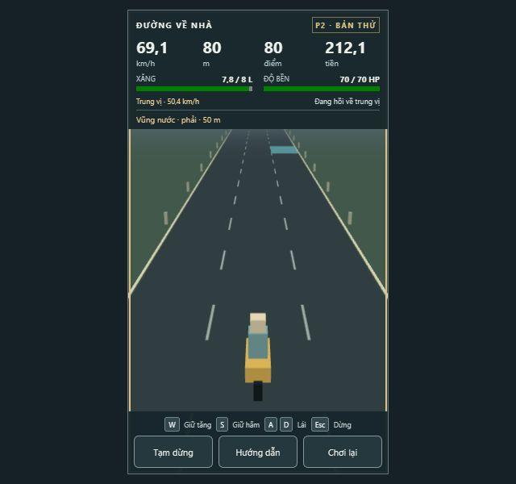
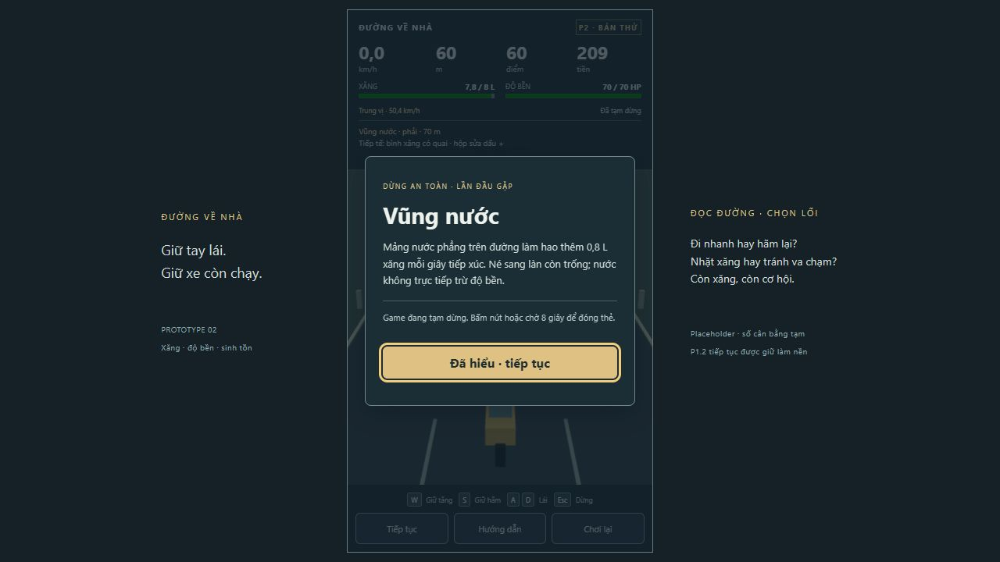
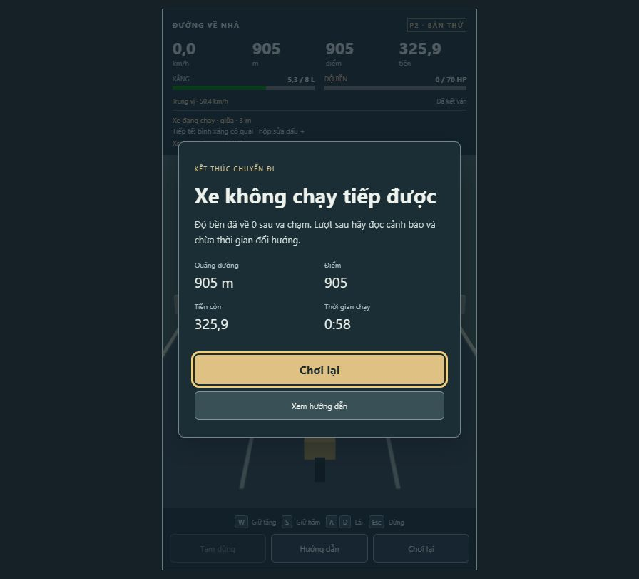

# P2 — sinh tồn, tài nguyên và nền economy

Ngày 17/10/2026, UTC+7. Codex **tự review** từ dữ liệu/test và browser hiện tại, không có reviewer chuyên môn độc lập.

## Bản bàn giao

- Branch: `feature/prototype-2-survival`, từ P1.2 `8caac16` đã được chủ dự án đồng ý cho tiếp tục. Code P2: **`3305258`**, config `p2.0`.
- Production JS **`index-Bs4UxLbD.js`**, CSS `index-h8BZ8nni.css`; xem http://127.0.0.1:5173/ . Seed mặc định 17, restart cùng seed để tái hiện feedback.
- Đã có: lái/cruise P1.2; xăng/HP riêng; nước/ổ gà/xe đang chạy; nhặt xăng/sửa; điểm/tiền theo distance; trôi 25 m khi cạn; kết ván/lưu local một lần/restart; cảnh báo, card pause lần đầu, Help, phản hồi và tùy chọn tắt lời nhắc vui.
- Chủ dự án đã **đồng ý thử 0,15 tiền/m** thay 0,02. Không đổi giá xe/bonus hành khách. Đây là số tạm, chưa khóa economy.
- Chưa có: giao lộ, director độ khó P3, hành khách/nhiều xe, shop, inventory R, nitro/tàu, secret. Nhặt tiếp tế hiện phục hồi trực tiếp; chưa phải mua/sử dụng inventory. Không art/SFX hoàn chỉnh; chưa thêm âm thanh prototype.

## Gates và môi trường

Windows NT 10.0.22621; Node 24.19.0; pnpm 11.25.0. Tên CPU/GPU đầy đủ chưa được xác nhận, không ngoại suy số FPS sang máy khác.

| Gate | Command | Exit | Kết quả thật |
|---|---|---:|---|
| Lint | `pnpm lint` | 0 | Pass |
| Typecheck | `pnpm typecheck` | 0 | Pass, strict |
| Tests | `pnpm test` | 0 | **26/26**, 6 files |
| Production | `pnpm build` | 0 | Pass, JS ~496,58 kB / 128,51 kB gzip |

Log cuối: [checks-p2/](checks-p2/). Code không đổi sau các check được ghi ở đây; commit sau chỉ thêm báo cáo/evidence. Rà diff/scope/whitespace và credential patterns trong src/tests không thấy secret. Fixture DEV `qa-fuel` được kiểm tra không xuất hiện trong JS production; `scenario` không là lựa chọn chơi bản release.

## Các vòng simulation/playtest và review sau vòng

| Vòng | Thực nghiệm/quan sát | Game-design self-review | UI/UX self-review và hành động |
|---|---|---|---|
| R1 — core P2 | 22/22 test pass: tài nguyên, swept collision, nước, cooldown, terminal chronology, lưu local và hồi quy P1.2. | Tách HP và fuel đúng; không hồi cruise khi cạn; pickup về sau không cứu một va chạm chí tử trước đó. Chưa đánh giá economy chỉ từ unit tests. Không đổi damage/fuel tạm. | Tạo HUD số + progress và card pause an toàn; cần browser để kiểm tra vùng đường/cảnh báo. |
| R2 — bot + browser, JS `index-3v7W7mtD.js` | 9 kịch bản bot × 600 s; thêm checks FPS và discovery/result/restart: 25/25 tests. Typecheck ban đầu fail vì thiếu type `node:fs` ở test đọc HTML thật; thêm @types/node rồi pass, không hạ strict/rule. Browser giữ thẳng/W thua do HP ở ~905 m, 58 s chạy, tiền 325,9, còn ~5,3 L. | Có đường chơi sống 10 phút ở mẫu bot, trong khi bỏ né có thể thua sớm; chưa chứng minh mọi seed/cách chơi đều cân bằng. Thu nhập được thay sau khi chủ dự án trả lời đồng ý. Không tự tăng difficulty. | Card timeout 8 s hoạt động, nhưng một lần capture chậm đã qua card nên ảnh không được nhận là ảnh card; chụp lại trên origin QA mới. Cần bớt HUD trống ở viewport thấp, sửa câu feedback coasting tĩnh “còn 25 m” để không mâu thuẫn countdown hiện tại. |
| R3 — DEV QA + cuối `3305258` | Fixture manual cạn xăng: 2 m powered + 25 m coast = 27 m rồi end, HP 70. Fixture supplies từ fuel 0/HP30 nhặt xăng và sửa lên HP70, fuel không vượt 8. Cuối 26/26 test; sample resource/RNG ở nhiều FPS bằng nhau. | Coasting/thu hồi xăng hoạt động đúng trong kịch bản có kiểm soát. Fixture không thay thế sampling world thật. Số gameplay giữ nguyên sau vòng R2; chỉ sửa hướng dẫn/feedback và thêm preference/caption, không thêm sức ép. | Ẩn dòng tiếp tế/feedback trống để nhường đường; số hậu quả đứng trước flavor. Ba caption mỗi nhóm, tự biên tập, không dùng gameplay RNG; chờ chủ dự án nhận xét tone. Card/Help, toggle và 640×600 đã kiểm tra. |

Mỗi vòng trên là tự review có bằng chứng, không giả chuyên gia độc lập. Các lần chạy lại cùng input/seed là hồi quy, không đếm thành người chơi mới. Thay đổi balance lớn duy nhất là income đã được người dùng duyệt thử.

## Simulation cuối — hành vi và economy

- Xăng khi chạy, score/money tăng theo distance hợp lệ; nước cộng tiêu hao theo thời gian tiếp xúc thực. Pause/ready/end không thêm thu nhập/tài nguyên/tick.
- Swept slab 2D xét cả lái ngang và xe chuyển động, bắt được vật mỏng vượt giữa hai frame. Event xếp timestamp và tie-break ổn định; HP về 0/fuel coast end chặn mọi event về sau cùng tick.
- Ổ gà chỉ một lần/entity; tiền tối thiểu 0. Cùng xe có cooldown 1 s. Nhặt đồ chỉ một lần, clamp max. Result theo runId, restart bỏ toàn bộ state/consumed cũ; có test save hỏng/duplicate.
- Thẻ lần đầu dừng trước hazard (test dưới 100 m trong khi nước ở 130 m), tài nguyên đứng yên khi đọc, auto-close 8 s được test bằng fake timer. Lưu seen cards local, Help xem lại quy tắc.
- Lái P1.2 vẫn có 3 seed × 20 phút và lặp seed 42. P2 survival/va chạm/RNG/fuel/money có toàn State bằng nhau tại render 30/60/144 Hz trong scenario 100 s. Không suy movement-only test thành survival test.

Bot đọc entity trong phạm vi 80 m, chọn lane và nhặt khi cần; bot có thông tin cấu trúc chuẩn nên **không đại diện thời gian phản ứng người thật**. Mỗi dòng dưới gồm 3 seed 17/42/20261017, mỗi scenario chạy 10 phút. Không có người đi nhờ/shop/chi phí mua vật phẩm trong mẫu này.

| Chiến thuật | Thời gian đủ 800 tiền | Sống hết 10 phút | HP cuối | Entity hoạt động tối đa |
|---|---|---|---|---:|
| Chủ yếu cruise | **285,72–290,48 s** (4:46–4:50) | 3/3 mẫu | 30–70 | 4 |
| Giữ W | **200,18 s** (~3:20) | 3/3 mẫu | 70 | 4 |
| Giữ S | **499,78 s** (~8:20) | 3/3 mẫu | 50–70 | 5 |

Quãng đường sau 10 phút lần lượt ~8.400 / 11.996,4 / 4.801,8 m. Một seed cruise có mất 20 tiền do ổ gà, nên mốc tiền muộn hơn; số phản ánh hậu quả thực chứ không chỉ công thức lý thuyết. Không có vi phạm được kiểm tra về finite, biên, HP/fuel âm hoặc vượt max. Đây là lấy mẫu ba seed, không chứng minh mọi spawn khả thi.

**Economy review:** mẫu cruise/W nằm trong mục tiêu cơ hội mua xe 3–5 phút. Giữ S liên tục chậm hơn là lựa chọn nhịp chạy, không phải mọi chiến thuật bắt buộc đạt cùng mốc. Đây chỉ là **đủ 800 tiền**, chưa phải mua xe thật. Khi thêm shop, hành khách, nâng cấp và tiêu tiền cần cân lại cùng mục tiêu, hỏi trước khi đổi lớn. Không mặc định ba seed bot pass nghĩa economy cuối đã đạt.

**Pacing/fairness review:** hazard một lane, cách 90 m (~6,4 s tại cruise, 4,5 s tại max), xe ở giữa có hai bên để vượt; warning ≥60 m hoặc 3,5 s theo tốc độ. Nhịp hiện có thể lặp/predictable vì P2 dùng chu kỳ ba loại, chưa director P3. Không tăng damage/mật độ để bù cảm giác lặp; lấy feedback trước, rồi làm variety/giao lộ theo roadmap. Giữ S khi chạm xe có thể làm tiếp xúc lâu hơn và nhận nhiều cooldown hits; phải xem người chơi có đọc được điều này qua cue/Help.

## Manual và UI/UX audit

Trình duyệt: ChatGPT in-app browser, production localhost:5173; DEV fixture ở :5174, ghi rõ dưới đây. Thao tác có nhấn phím/click, không chỉ nhìn screenshot. Ảnh được chụp/xem trong lượt hiện tại; snapshot ngay chuyển UI có thể cũ một frame, nên xác nhận bằng khung kế tiếp.

1. **Start và input — đạt phạm vi P2:** [01](evidence-p2/01-start.png) là UI vòng R2; [08](evidence-p2/08-small-start.png) là UI cuối 640×600. Start, W/S, A/D và restart được thử, giữ cruise P1.2. Không gọi mobile hỗ trợ input.
2. **Đọc đường — đạt mẫu:** [02](evidence-p2/02-first-card.png) thực tế là cảnh báo nước, không phải ảnh card (tên file cũ). [09](evidence-p2/09-small-driving.png) cho thấy cảnh và cue ở 640×600 sau thu gọn HUD. Mốc tốc độ, xăng/HP và đường không bị chồng trong mẫu; font chú thích nhỏ cần feedback thật.
3. **Card đầu — đạt mẫu:** [03](evidence-p2/03-discovery.png), origin QA sạch localhost, pause ở ~60 m khi nước còn ~70 m. Timeout tự đóng đã thấy qua chuyển trạng thái, và có test kiểm tra không hao tài nguyên trong pause. Một lần click sau khi card tự đóng đã timeout do không còn nút; không coi lần thao tác đó là pass. Không đổi timer để chiều tool.
4. **Nước/va chạm — đạt mẫu:** [11](evidence-p2/11-water-contact.png), lái vào nước phải ở production: ~149 m, fuel ~7,193 L, HP vẫn 70 (so fuel cơ bản ~7,553 L, nước hao thêm ~0,36 L). [04](evidence-p2/04-survival.png) là kết ván thật HP0 ở ~905 m; điểm/tiền giữ nguyên qua quan sát sau end. Pothole/cooldown còn có kiểm tra tự động chính xác.
5. **Cạn xăng/nhặt đồ — đạt fixture manual, chưa giả là world ngẫu nhiên:** [05](evidence-p2/05-coasting-dev.png) thấy fuel0 vẫn giảm tốc dù W giữ, countdown đà; [06](evidence-p2/06-fuel-end-dev.png) kết ở 27 m đúng 2+25. [07](evidence-p2/07-supplies-dev.png) cho thấy nhặt xăng chạy lại và sửa HP30→70. Chỉ fixture DEV, bị loại khỏi production.
6. **Pause/Help/settings/restart — đạt mẫu:** [10](evidence-p2/10-help.png). Pause giữ 308 m / 246,3 tiền / 7,1 L qua hai quan sát; Help ghi đúng số. Checkbox flavor được thử tắt và bật lại, numeric feedback vẫn là dữ liệu riêng. Có test focus trap với checkbox, blur xóa input và 10 restart; main result replay cũng đã nhấn thử. Chuyển tab/Alt+Tab desktop thông thường **CHƯA KIỂM TRA THỦ CÔNG** đầy đủ vì IAB không tương đương browser tab visibility; handler có DOM test.

Hiệu năng cuối: 1.200 frame đã lấy mẫu, cửa sổ 600 frame gần nhất ~**60,002 FPS**, p95 **16,8 ms**, CPU submit render trung bình **0,670 ms**. Có pooling mesh theo loại và world prune; sample bot tối đa 4–5 entity. CPU submit không phải GPU timing. Chưa kiểm tra nhiều GPU/browser/zoom/screen reader; không tuyên bố WCAG compliance hay sạch mọi bug.

Log error/warn từ browser tool ở bản cuối: rỗng. Đã trả viewport về mặc định, bật lại preference flavor sau kiểm tra và mở P2 ở màn start (0 m/200 tiền/8 L/70 HP) để chủ dự án chơi.

## Bàn giao / điều kiện còn thiếu

P2 sẵn cho chủ dự án chơi thử, **chờ phản hồi** về nhịp hazard, dễ đọc cue, xăng/HP và income 0,15. Chưa khóa balance, chưa bắt đầu P3. Không có art/SFX production mới. Caption là tự biên tập placeholder, chưa có review tone độc lập/chủ dự án; có thể tắt mà giữ số hậu quả.

Repo không có remote/main từ xa nên không fetch/fast-forward, push, PR hoặc CI remote. Đã dùng nhánh local riêng từ P1.2 được chấp nhận, giữ main nguyên trạng và chuẩn bị patch/source để review theo fallback AGENTS.md; không tuyên bố đã merge base hay tạo PR. Workflow checks đã có, local gates thật ở trên. Đang chờ review con người cho revision P2; **chưa merge**. Sẽ cần remote, CI và các manual checks còn thiếu trước khi đủ điều kiện merge/phát hành.
