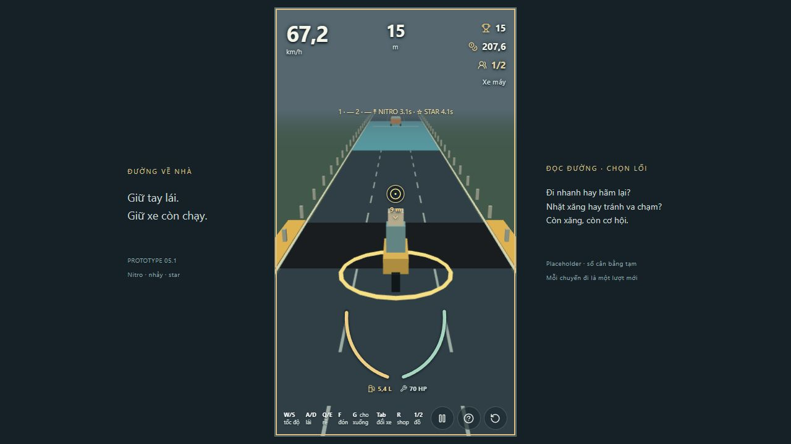
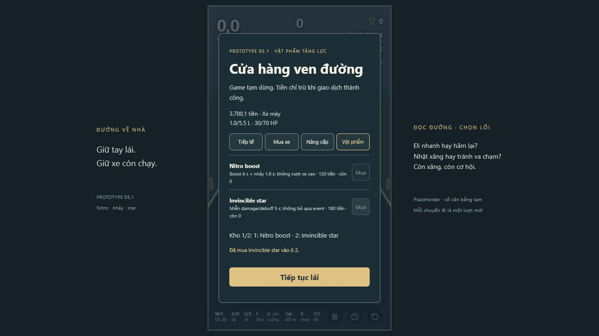

# P5.1 — Nitro/nhảy, star và kho hai ô

18/10/2026. Config `p5-1-power-items-1`. Branch `codex/p5-1-power-items`, base local P5 `ebd0b2c`. Codex tự review từ simulation, test DOM và thao tác in-app browser; không có reviewer độc lập.

## Chạy thử

- [Cảnh thử có sẵn hai món](http://127.0.0.1:5173/?scenario=items&seed=17): bắt đầu, nhấn 1 trước ổ gà để boost/nhảy; nhấn 2 trước nước/xe để bật star. Có thể chơi lại để so sánh có/không dùng món. Cảnh này là DEV fixture, không phải tài nguyên miễn phí của ván thường.
- [Xe dài](http://127.0.0.1:5173/?scenario=items-container&seed=17): cùng cảnh với container để thử footprint lúc hạ cánh.
- [Ván thường](http://127.0.0.1:5173/?seed=17): kho trống đầu ván, R ghé shop; mỗi shop có một nitro và một star, mua vào ô trống đầu tiên. Dùng 1/2 hoặc numpad tương ứng, Tab vẫn đổi xe.

## Hành vi và các số TẠM

Nitro: boost 4 s, trần tốc độ ×1,3, tự tăng tốc nếu không giữ S; kích hoạt kèm một cú nhảy 1,6 s cao 2,4 m. Hết boost hồi tốc mượt, không reset tài nguyên. Nitro chỉ dùng khi xe còn lực kéo/xăng. Chạm xe cao hoặc hạ cánh còn đè chướng ngại vẫn chịu hậu quả; toàn bộ footprint phải qua hết. Ngã hủy boost/flight.

Star: 5 s miễn damage/debuff thường, cả hao xăng thêm do nước, mất tiền ổ gà và ngã do va xe/rào thường; vẫn hao xăng chạy nền, vẫn có thể hết xăng. Không tự gây damage cho traffic khi lướt qua. Event giao lộ vẫn tiến và ghi miss. Công an/dân phòng/tàu chưa có ở P5.1; không tuyên bố đã thử hoặc hoàn tất các tương tác này. Luật thiết kế giữ trigger và terminal tàu, kiểm chứng ở P6.

Giá thử nitro 120, star 180; một món mỗi loại/shop, không refresh. Hai ô cố định không dồn; không dùng khi pause/ngã/kết ván; cùng hiệu lực đang chạy không tiêu thêm món. Có thể đồng thời bật hai hiệu lực khác loại. Timer chạy trong simulation, dừng khi pause/shop/Help. Không khôi phục gói xăng/bộ sửa. Grab, chuối và hazard mới tiếp tục theo roadmap, chưa triển khai.

Simulation tách tick tại hết hiệu lực và giao điểm độ cao collider, nên không miễn nhiễm cả tick khi đang cất/hạ cánh. Renderer chỉ biểu diễn độ cao và vòng primitive; không làm art/VFX hoàn chỉnh. Clearance/giá/thời lượng có đơn vị và validation ở config. Chưa khóa cân bằng các con số trên.

## Gate tự động trên code cuối

Môi trường Windows, Node 24.19.0, pnpm theo packageManager/lockfile.

| Command | Exit | Kết quả |
|---|---|---|
| `pnpm lint` | 0 | Pass |
| `pnpm typecheck` | 0 | Pass |
| `pnpm test` | 0 | 110 test / 20 file pass, tổng 12,78 s |
| `pnpm build` | 0 | Pass, chunk JS 561,21 kB; cảnh báo >500 kB còn tồn tại |
| `pnpm simulate` | 0 | 24 test / 3 file pass, 11,31 s; đã thêm simulation vật phẩm vào script này |

Test mới bảo vệ command/stock/tiền/ô/stale replay, input thật, giữ phím không lặp, pause/restart, timer hết giữa tick, star không cứu hết xăng, ngã hủy boost, không phá traffic bằng star, đủ tám footprint khi đáp xuống ổ gà dài, xe thấp/xe cao, đổi xe không nhân món, event giao lộ vẫn ghi miss và kết quả khớp 30/60/144 render FPS.

Lần đầu suite bị timeout ở bài survival 15 s; đã giảm cấp phát/tính clearance khi không nhảy và giữ đường fixed-step nhanh khi không có hiệu lực. Giữ nguyên số seed/assertion và timeout của bài survival; lần cuối bài đó 12,01 s. Một lỗi lint `prefer-const` đã sửa. Một fixture kiểm tra hạ cánh ban đầu bị xe container húc phá nên không ngã theo luật ram hợp lệ; fixture được sửa để collider còn HP sau húc, không sửa luật ram để ép test pass.

## Simulation thực tế

- 20 seed 1–20, mỗi seed 30 giây chạy hai lần với cùng input, dùng nitro tại tick 180, star tại tick 600: tái hiện đúng, finite, tất cả còn running; distance 407–472 m. Đây là kiểm tra độ ổn định, không phải bot dùng món tối ưu hay bằng chứng game đã vui/khó.
- Movement 20 phút/seed 17, 42, 20261017 vẫn finite/reproducible. Bộ baseline không dùng vật phẩm mới giữ kết quả cũ: 30 seed/chiến thuật cruise/W/S đều đủ tiền ô tô; trung vị 85,72/60,18/149,78 s, số chết 9/13/2. Không suy từ baseline này rằng giá món đã cân.
- Mua ô tô thật riêng: cruise 29/30, W 28/30; median 85,72/60,18 s. Chi phí mua món là lựa chọn có thể lùi thời điểm mua xe; chưa có mẫu đại diện chứng minh economy khi thường xuyên mua món.

## Manual và UX chức năng — in-app browser, seed 17

1. Fixture items: bắt đầu, nhấn 1 và giữ W 600 ms, Esc: ô 1 trống, ô 2 còn star, timer nitro 3,4 s. Nhấn 2 khi pause không làm thay đổi kho/timer. Thao tác và AX xác nhận, không suy từ ảnh.
2. Tiếp tục, dùng 2: hai ô trống, HUD có NITRO/STAR cùng thời lượng. Xe nâng lên và có vòng vàng placeholder; chạy qua hole/water/car của fixture, tới 156 m còn 70 HP, xăng khoảng 4,8 L; hiệu lực hết tự biến mất. Sau đó restart trả hai món DEV, timer cũ không còn.
3. Ảnh lần đầu cho thấy timer gần số fuel/HP. Đã chuyển timer lên vùng trời trống; [ảnh sau sửa](evidence/p5-1/01-powers.png) xác nhận không chồng số tài nguyên ở viewport này. Chỉ sửa lỗi đọc, không polish art.
4. Fixture shop: R → Vật phẩm → mua nitro vào ô 1, star vào ô 2. Ví 4.000,1 → 3.880,1 → 3.700,1; resource 1 L/30 HP không tăng, stock về 0, nút mua khóa. [Ảnh kho/stock](evidence/p5-1/02-shop.png).
5. Fixture vehicle-failure: W 1,8 s, va chạm hết HP tại khoảng 4 m, màn kết quả hiện đúng; Chơi lại trở về fixture và xe chạy lại. Regression terminal thường/restart đã thao tác.

CHƯA KIỂM TRA THỦ CÔNG: toàn bộ tám xe ở mọi timing đáp đất, trường hợp hết xăng trong flight, nhiều giao lộ khi đang boost và tương tác P6 chưa tồn tại. Các ca footprint/fuel/FPS có test tự động riêng. Chưa đo 60 FPS trên máy tham chiếu hoặc accessibility toàn diện; ảnh không chứng minh timing/fairness. Theo lựa chọn chủ dự án, chưa làm review/polish visual art hoàn chỉnh.

## Tự review thiết kế

**Dữ kiện:** cú nhảy không bảo vệ phần boost còn lại sau khi đáp; xe dài có thể còn footprint trong vùng nguy hiểm. Star chặn trọn các hazard thường của fixture trong 5 s, không cần né xe đó. Đây là hai trải nghiệm chiến thuật khác nhau, không gọi món nào đã cân từ suite pass.

**ĐỀ XUẤT cho lượt chơi tiếp:** so sánh ít nhất 10 lượt cùng seed có/không mua món; ghi hazard tránh/món, số lần đáp đất bị va, tiền ròng/phút và thời điểm mua xe thật. Nếu star thường xuyên xóa nhiều nhịp nguy hiểm liên tiếp, thử giảm thời lượng hoặc tăng độ khan hiếm từng biến một; chưa áp dụng. Với nitro, trước tiên đánh giá người chơi có đọc được điểm đáp hay không; nếu hay đâm ngay khi đáp, thử cue điểm đáp trước khi giảm độ khó/đổi jump. Không tăng mật độ chỉ để khắc chế món.

**UX:** phím ô hoạt động liền mạch, không dồn ô; shop có effect/duration/stock, HUD có timer chữ + ký hiệu và không phụ thuộc riêng màu vòng. Hạn chế còn lại: nhận biết vùng đáp và món không dùng được lúc coasting cần playtest thêm; cân nhắc cue ngắn, không thêm bảng log. Timer mới đã tránh fuel/HP trong ảnh hiện tại, cần kiểm tra thêm viewport nhỏ trước art cuối.

## Git và phê duyệt

P5 đã được lưu thành commit local `ebd0b2c` trước tạo branch này, giữ nguyên feedback đã duyệt. Repo chưa có remote cấu hình/main cập nhật nên base P5.1 là local; không giả vờ fetch/main/PR/CI đã hoàn tất. P5.1 chỉ bàn giao local; chưa push/tạo PR, CI chưa chạy, chưa merge. Chờ chủ dự án chơi và đánh giá revision P5.1. Phê duyệt P5 không phải phê duyệt merge P5.1.

Điều khiển tự nhảy ở báo cáo này là lịch sử P5.1 đầu. Yêu cầu mới đã tách nitro boost và Space nhảy; xem [NITRO_SPACE_REVIEW.md](NITRO_SPACE_REVIEW.md) cho revision/test hiện tại.
