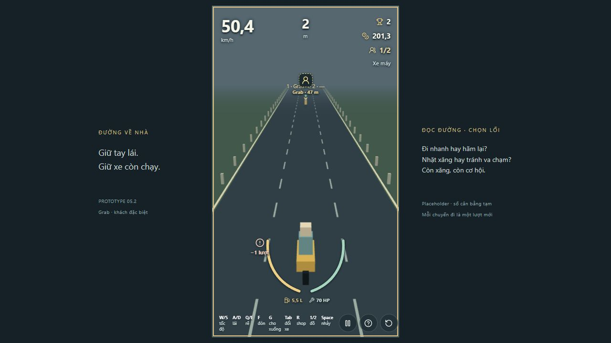
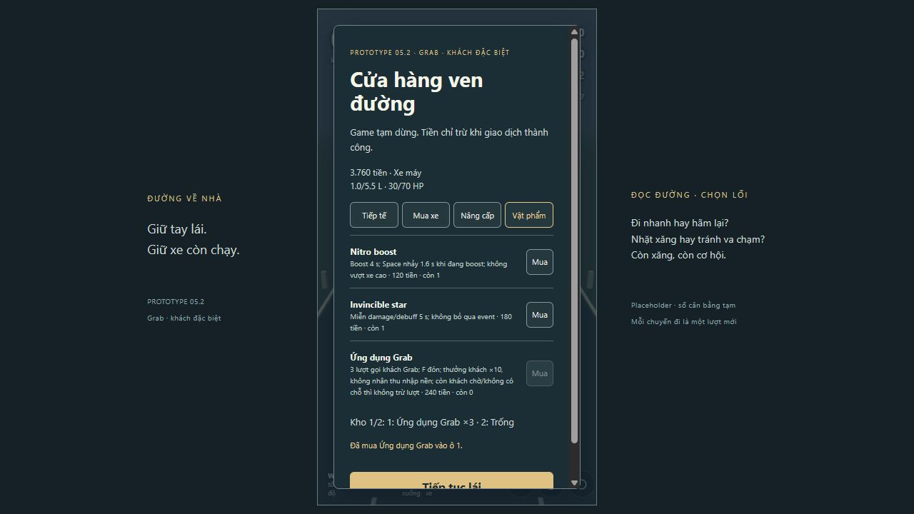

# P5.2 — Grab và khách đặc biệt

18/10/2026. Config `p5-2-grab-1`, branch `codex/p5-2-grab-passengers`, base local `c7ed808`. Codex tự review từ command/test/simulation và thao tác in-app browser; không có chuyên gia độc lập.

## Chạy thử và phạm vi

- [Grab có sẵn 3 lượt + ô tô dự phòng](http://127.0.0.1:5173/?scenario=grab&seed=17): bắt đầu → nhấn 1 gọi → lái tới dấu khách Grab → F đón. Tab đổi ô tô, G cho xuống. Fixture DEV cấp sẵn gói/xe để thử, ván thường không có quà này.
- [Không có chỗ gọi](http://127.0.0.1:5173/?scenario=grab-blocked&seed=17): fixture cố ý chặn toàn bộ vùng tìm kiếm, nhấn 1 không mất lượt. Không coi fixture này là mẫu spawn hợp lệ của ván thường.
- [Tai nạn với 3 khách Grab](http://127.0.0.1:5173/?scenario=grab-crash&seed=17): thử văng/ngã, khách quay lại hoặc từ chối như luật đã có.
- [Ván thường](http://127.0.0.1:5173/?seed=17): mua Grab trong shop bằng R → Vật phẩm; dùng phím ô 1/2. Nitro vẫn boost riêng, Space mới nhảy.

Số TẠM: 240 tiền/gói, 3 lượt, một gói mỗi shop, cooldown gọi 2 s, một khách Grab còn chờ mỗi lần. Món giữ đúng ô đến hết lượt; không dồn ô hoặc hồi lại lượt khi đổi xe. Khách xuất hiện phía trước 45–120 m, tối thiểu cửa sổ cảnh báo theo tốc độ; không trừ lượt khi thiếu pocket an toàn hoặc chưa chọn nhánh có thể chứa khách. Không tạo tiền/khách trên xe khi gọi, phải F đón. Bỏ lỡ khách không được hoàn lượt.

NPC Grab có marker primitive và nhãn để nhận ra loại; loại/ID theo khách qua cho xuống, đón lại, đổi/mua xe và tai nạn. Người không quay lại vẫn từ chối F và không cộng tiền. Slot, số người tính tài xế, quá tải/cruise, điểm và xăng/HP theo hệ cũ. Thưởng mỗi khách Grab thử ×10 phần thưởng khách thường: 0,10 tiền/m thay 0,01; không nhân base 0,50/m hay toàn bộ tiền. Không làm Grab/khách thành unlock hoặc backend.

## Gate thực tế

Windows, Node 24.19.0, pnpm theo packageManager/lockfile. Các command dưới đây chạy trên code cuối; tài liệu/bằng chứng thêm sau không đổi gameplay.

| Command | Exit | Kết quả |
|---|---|---|
| `pnpm lint` | 0 | Pass |
| `pnpm typecheck` | 0 | Pass |
| `pnpm test` | 0 | 123 test / 22 file pass, 13,18 s |
| `pnpm build` | 0 | Pass; cảnh báo chunk JS 568,27 kB còn tồn tại |
| `pnpm simulate` | 0 | 36 test / 4 file pass, 11,46 s; script đã chứa test Grab |
| `git diff --check` | 0 | Không lỗi whitespace; còn cảnh báo LF/CRLF |

Các test mới bảo vệ ba lượt/ô, stock/giá/stale sequence, không tự board/thưởng, không gọi lặp khi có NPC chờ/cooldown, spawn bị chặn/traffic đang tiến tới, 80 tổ hợp seed/loại xe cho footprint, hazard RNG không reroll, không sinh hazard mới đè pocket đã chọn, type qua G/F và Tab, crash 10 seed giữ đúng người quay lại/rời đi, bỏ lỡ khách, reset ván và input/HUD thật trong DOM. Crash và NPC từ chối dùng luật cũ, không ép kết quả ngẫu nhiên thành n−1 người.

Một test ban đầu chọn rẽ ngoài cửa sổ QTE nên không có nhánh đã chọn để gọi; đã sửa fixture vào đúng cửa sổ và thêm assertion xác nhận route.choice trước thử spawn, không nới luật giao lộ. Lint bắt một biến test cần const, đã sửa.

## Dữ liệu simulation và economy

[JSON kết quả thực](evidence/p5-2/simulation-summary.json), lấy từ stdout của `pnpm simulate` exit 0.

- Pilot 30 seed 1–30, mỗi seed 20 s chạy hai lần, gọi và gửi lệnh F thật trong simulation, giữ x theo NPC: tái hiện đúng, không âm lượt/nhân roster. Cả 30 lượt gọi thành công 3 lần và đang chở 3 khách ở cuối, distance 203–205 m, chưa ai chết. Fixture cấp gói miễn phí cho test nên tiền cuối 336,65–337,26 **không phải lợi nhuận sau mua gói**, và 20 s không chứng minh curve dài đã đạt.
- Test cùng tải trên đường trống, 60 giây, giữ cruise, không trừ tiền gói:

| Xe / số khách | Khách thường: tiền kiếm | Khách Grab: tiền kiếm | Quãng đường |
|---|---:|---:|---:|
| Xe máy / 0 | 420,00 | 420,00 | 840 m |
| Xe máy / 1 | 367,45 | 432,30 | ~721 m |
| Xe máy / 3 (quá tải) | 256,79 | 387,60 | ~484 m |
| Ô tô 4 / 3 | 357,69 | 539,90 | ~675 m |
| Buýt / 3 | 368,93 | 556,88 | ~696 m |
| Buýt / 12 | 332,08 | 910,55 | ~536 m |
| Buýt / 24 | 313,60 | 1.228,97 | ~424 m |

Tiền này là gross trong 60 s với roster có sẵn, không gồm chi phí mua/thu gom nhiều gói. Với đủ 3 khách Grab thay 3 khách thường và giữ cùng tải, chênh lệch +0,27/m; gói 240 có mốc hòa phần chênh lệch lý tưởng ~889 m sau khi đã gom đủ ba người. Không coi đó là hòa vốn thực tế so với chạy solo hoặc có tai nạn.

Baseline không Grab giữ kết quả cũ: 30 seed mỗi chiến thuật cruise/W/S đều đủ tiền ô tô; median 85,72/60,18/149,78 s, số lượt chết 9/13/2. Mua ô tô thật riêng vẫn cruise 29/30 và W 28/30. Chưa đo mục tiêu mua ô tô đại diện với chiến thuật thường xuyên bỏ tiền mua Grab; lựa chọn mua gói trước xe sẽ lùi mốc mua.

## Manual browser và bằng chứng

In-app browser, seed 17, code P5.2. Đây là thao tác input thực; ảnh không thay thế kiểm tra logic/timing.

1. `grab`: bắt đầu → 1. HUD giảm Grab×3 thành Grab×2, cue khách Grab phía trước ~47 m, sức chứa vẫn 1/2. Pause giữ trạng thái. [Ảnh sau gọi](evidence/p5-2/01-called.png).
2. Tiếp tục, W 2 s, F rồi pause: tại ~40 m HUD 2/2, còn hai lượt. Tiếp tục Tab rồi pause: 2/4, ô tô 4 chỗ, vẫn hai lượt; tài nguyên xe tương ứng không reset xe máy. G cho xuống → 1/4. Không dựa vào biến động ví nhỏ giữa hai frame để kết luận mức bonus; phần đó có test theo ds riêng.
3. Restart: về màn bắt đầu, 1/2, Grab×3 của fixture, không có khách cũ. Đây là reset fixture; ván thường khởi tạo hai ô trống/lượt 0.
4. `shop`: R → Vật phẩm → mua Grab. Ví 4.000 → 3.760; kho ô 1 Grab×3, stock 0 và nút mua khóa; fuel/HP vẫn 1 L/30 HP. [Ảnh shop](evidence/p5-2/02-shop.png).
5. `grab-blocked`: bắt đầu, 1, pause. Vẫn Grab×3, không có cue NPC mới.
6. `grab-crash`: bắt đầu 4/4, W 1 s rồi pause → 0/4 trong pha ngã, HP 100. Tiếp tục W 3,5 s rồi pause → 2/4 (tài xế + một khách), không mọc lại hai khách đã rời. Nhấn F sau phục hồi vẫn 2/4. Test nhiều seed kiểm tra metadata của nhóm quay lại/rời đi để tránh suy từ riêng seed này.

CHƯA KIỂM TRA THỦ CÔNG lại mọi xe/seed/timing rẽ, terminal failure hoặc ván dài tích nhiều gói. Có test hồi quy tương ứng ở mức simulation; event công an/tàu vẫn dành P6. Chưa đo FPS trên cấu hình tham chiếu. Không tuyên bố accessibility/art direction đạt từ các ảnh này.

## Tự review gameplay và UX chức năng

**Dữ kiện:** Grab thêm quyết định gọi, tiếp cận, F đón; không là nút cộng tiền. Quá tải xe máy làm 3 khách Grab kiếm/phút thấp hơn chạy solo; trên ô tô/buýt Grab có lợi hơn. Tích 24 khách Grab trên buýt làm gross gần 3,92 lần roster thường cùng tải trong test đường trống. Chưa có dữ liệu live lâu dài chứng minh giá/bonus đã cân.

**ĐỀ XUẤT chưa áp dụng:** đưa bonus/giá/stock Grab thành mục riêng ở P8, trước khóa economy. So sánh tối thiểu 10 lượt/chiến thuật “mua xe trước”, “mua Grab trước”, “buýt tích nhiều khách” trên cùng seed; đo tiền ròng sau mua gói, quãng đường hoàn vốn, khách mất do tai nạn, lượng hazard tránh do pocket và thời gian xăng thấp. Nếu buýt tích khách trở thành lựa chọn áp đảo, thử giảm multiplier hoặc giới hạn nguồn gói từng biến một; không tự áp soft cap hay tăng phạt/mật độ để bù. Mặc định an toàn đón khách có thể làm đường thoáng hơn vì chặn hazard mới đè pocket, cần đo cùng difficulty curve.

**UX chức năng:** nhận biết loại/remaining và F đón hoạt động, G vẫn dành cho cho xuống (nhãn Grab viết đầy đủ để tránh nhầm G). Ảnh sau gọi có cue NPC gần dòng lượt; shop dài cần cuộn ở viewport hiện tại. Ghi cho P UI theo yêu cầu chủ dự án, chưa thay bố cục/polish hoặc mở lượt audit visual. Hướng dẫn có nói một khách đang chờ/không có chỗ thì giữ lượt; phản hồi khi gọi thất bại vẫn tối giản, cần xem lại khi làm UX hoàn chỉnh.

## Git / PR

Branch riêng từ bản P5.1 đã được chủ dự án chấp nhận chơi thử. Repo vẫn chưa cấu hình remote/main mới để fetch; đây là bản local có thể review, không giả vờ đã dựa remote main. Chưa push/tạo PR/CI, chưa merge. Kết quả test không thay thế phê duyệt con người cho revision mới; commit local báo ở bàn giao. Phê duyệt prototype trước không được coi là phê duyệt merge P5.2.

Cập nhật vị trí chờ: khách Grab chỉ spawn ở hai ven đường theo seed, thay vị trí trong lane của P5.2 đầu. Xem [GRAB_ROADSIDE_REVIEW.md](GRAB_ROADSIDE_REVIEW.md) cho kết quả mới.
