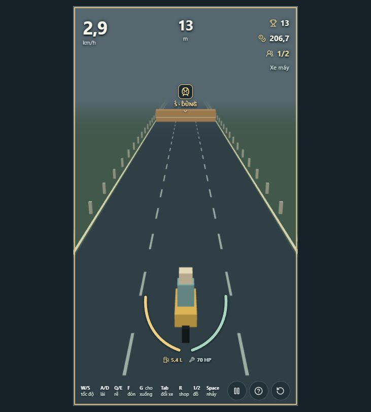
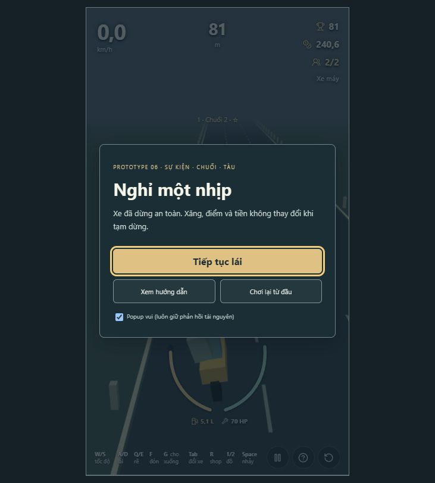

# P6 — sự kiện đặc biệt và chuối

Bản thử ngày 18/10/2026, sau khi chủ dự án duyệt Grab ven đường. Đây là **Codex tự kiểm tra và tự review** từ command thật, simulation và thao tác IAB; không phải review độc lập, không gọi cân bằng/art hoàn chỉnh đã đạt.

## Chơi thử
- [Công an + chuối](http://127.0.0.1:5173/?scenario=events-police&seed=17): xe máy, ô tô dự phòng; phím 1 chuối, 2 star. Không dùng chuối để thử tịch thu/thiếu tiền; chơi lại và ném khi cue hiện phím để so sánh.
- [Tàu + nitro](http://127.0.0.1:5173/?scenario=events-train&seed=17): 1 bật nitro, Space nhảy riêng; hoặc giữ S tới dừng, đợi cue đường mở rồi W. Đụng tàu luôn thua kể cả còn xe dự phòng/star.
- Thay scenario bằng events-militia / events-jam / events-accident / events-broken để thử từng nhóm. Các fixture DEV có đồ/xe mẫu miễn phí, không dùng để đo lợi nhuận kinh tế.
- [Ván bình thường seed 17](http://127.0.0.1:5173/?seed=17): event bắt đầu từ 1.700 m, có thể bỏ mẫu cạnh shop/giao lộ/khách Grab. Shop bán chuối 80/món TẠM, một món/shop. Production bỏ fixture/seed URL theo nhánh DEV hiện có.

## Revision và phạm vi
Branch codex/p6-special-events; base local 4cf9808 (Grab ven đường). Repo không có remote, không fetch/update remote main được; đây là patch/commit local nối bản đã được chấp nhận, không giả là PR từ remote main mới.
Source/test/HTML/package fingerprint SHA-256: 7c503a935da6ca0a846c6e0b277266b6984c6acbcaf6101ebfb2130349381e36. Mã nguồn không đổi sau lần gate cuối; commit chứa báo cáo này là revision bàn giao. Chi tiết máy đọc được: [simulation-summary.json](evidence/p6/simulation-summary.json).

Công an phạt cố định 300/tịch thu instance hiện tại. Thiếu tiền: lấy tới 0, dự phòng còn nửa xăng hiện có rồi tự chuyển; đủ tiền không trừ xăng dự phòng. Instance bị tịch thu bỏ khỏi kho khi chuyển thành công, giải phóng slot. Không còn xe hợp lệ thì kết ván. Dân phòng phạt tối đa số tiền đang có tới mức 100, không tịch thu/nợ.

Chuối chỉ tiêu một món cho một officer trong cửa sổ phản ứng, không tiêu ngoài tầm, pause, ngã hay sau kết ván. Star không vô hiệu phạt/tịch thu, tai nạn hỏng xe hay tàu terminal. Kẹt xe hai làn gây ngã rồi hồi phục; xe chết máy tạo đúng một NPC thực cần F, không tự thưởng/đón, TẠM 25% thêm chuối nếu ô trống.

Tàu dùng collider bề rộng đường, đóng/mở 8/8 s bằng activeSeconds, không phải animation giả quyết định kết quả. S gần ray phanh tới 0; thả hồi dần, W tăng nhanh hơn. Va chạm sweep có cả chiều dài xe, jump clearance 1,8 m; phân đoạn ở biên đóng/mở và độ cao. Tàu ưu tiên khi sự kiện trùng thời điểm; không để sửa xe sau đó cứu lượt thua, không tự thay xe để thoát tàu. Nhảy xe dài phải thật sự đủ khoảng bay; luôn có lựa chọn dừng chờ.

Director event stream độc lập seed/branch, gap 1.250 m, corridor 110 m TẠM; bỏ mẫu không phù hợp, không xóa hazard đã có hay reroll do mở shop. Fork retire event nhánh cũ, tạo ID nhánh mới. Kẹt/tai nạn hiện hai làn, không spawn màn ba lane bắt buộc nitro. P6.1–3 barrier/chuyển lane/lực ngang/đồ rơi và P7 chuỗi secret/badge chưa triển khai. Tàu và vụ tai nạn ở P6 là khối primitive để kiểm tra luật, chưa diễn cảnh hai xe đâm nhau hay tàu chạy ngang hoàn chỉnh.

## Gate tự động — Windows / Node v24.19.0 / pnpm 11.25.0
| Gate | Command | Kết quả thật |
|---|---|---|
| Lint | pnpm lint | exit 0 |
| Typecheck | pnpm typecheck | exit 0 |
| Tests | pnpm test | exit 0, 142 tests / 23 files, 14,43 s |
| Production build | pnpm build | exit 0; JS 577,88 kB, gzip 154,74 kB |
| Simulation | pnpm simulate | exit 0, 55 tests / 5 files, 12,47 s |

Build vẫn cảnh báo chunk >500 kB; chưa thay threshold để giấu cảnh báo. Không bỏ test/no-op/nới rule/timeout. Lần đầu test đã bắt được event xuất hiện trước cơ hội mua ô tô; dời onboarding event sau shop 1.200 m, không tăng thu nhập/đổi giá xe. Test nhánh đường cũ giả định luôn có hazard ngay sau giao lộ nay va với vùng an toàn event: fixture được tách riêng ordinary hazards, giữ nguyên assertions bảo vệ retire/khác nhánh; thêm test nhánh cho event thật. Sampler P5 được ghi rõ tắt special events để giữ baseline so sánh; không coi sampler đó là survival rate P6.

## Simulation và kết quả
- Movement 20 phút/seed 17, 42, 20261017: finite/reproducible; 30/60/144 render FPS cho cùng kết quả tài nguyên/RNG.
- Ma trận P6: seed 1–30 × 8 xe × 6 event = **1.440 ca fixture**, thêm 240 ca chạm tàu không phản ứng. Có 480 lần chuối tránh officer, 240 lần phanh dừng, 240 lần tai nạn đổi xe; 240/240 chạm tàu kết ván dù có dự phòng. Đây là phản ứng được lập trình và event đặt sẵn, không phải tỉ lệ sống trên tuyến ngẫu nhiên hay cảm giác của người chơi.
- Test riêng đủ/thiếu tiền, dự phòng không hợp lệ, giữ khách/tài nguyên, star với event, chuối sai cửa sổ/pause, ngã miễn hazard thường, tàu khi ngã, swept tốc độ cao/xe dài, tàu ưu tiên sửa xe/tai nạn trùng t, biên đồng hồ đúng tick, nhảy thành công/nhảy muộn, loot/khách một lần và stock shop.
- Baseline P5 (special events tắt, ordinary hazards giữ): 30 seed/chiến thuật đều có mốc đủ 800; median cruise 85,72 s, W 60,18 s, S 149,78 s. Sampler 600 s: tử vong 9/30, 13/30, 2/30; không phải số P6 đã cân bằng.
- Mua ô tô thật trên tuyến có hazard trước event đầu: cruise 29/30, median 85,72 s, lỡ shop seed 115; W 28/30, median 60,18 s, lỡ seed 102/126. Đây là cửa sổ đầu ván, không chứng minh economy sau nhiều lần phạt đã đạt.

## Manual — Codex in-app browser, seed 17
Đã mở localhost và thao tác bàn phím/click thực trong lượt này; không có URL-policy denial. Ảnh chỉ là evidence trạng thái, kết quả input bên dưới dựa trên chuỗi thao tác và HUD/AX đã quan sát.

| Ca | Quan sát thật |
|---|---|
| Công an không dùng chuối | Tự chuyển ô tô 1/4, xăng gần 8 L thay vì bình dự phòng 16 L; ví về gần 0 rồi cộng quãng đường tiếp theo. Revision cuối bật star vẫn tịch thu: 70 m, 0,9 tiền, 7,99 L, 120 HP. |
| Chuối đúng tầm | W tiến vào cửa sổ, phím 1, đi qua: 91 m, vẫn xe máy 1/2, ví 245,5, ô 1 trống. |
| Dân phòng + star | 88 m, xe máy 1/2, 70 HP, ví 144,4 (= 200 + khoảng 44,4 thu nhập −100); star còn 1 s. |
| Tai nạn + star | Chuyển ô tô dự phòng 1/4, 120 HP, gần 16 L; star còn 0,8 s. |
| Kẹt xe | Va vào: 0/2 khi tài xế rời xe, 70 HP; tiếp tục hồi phục: 1/2, chạy tiếp tới 101 m, không kết ván. |
| Tàu không né | Kết ván va tàu tại 68 m dù có ô tô dự phòng; có màn nguyên nhân, kết quả, Chơi lại. |
| Tàu phanh chờ | Chơi lại, giữ S 8,5 s rồi W 5,5 s: qua ray 70 m tới 83 m, 70 HP, lượt còn chạy. |
| Nitro + Space qua tàu | W 2,8 s, phím 1 rồi Space, W 1,8 s: tới 96 m, 70 HP, vẫn xe máy, ô nitro trống và boost còn 2,2 s. |
| Xe chết máy | Đi qua rồi F ở sai phía không đón; chơi lại, lái A về trái và F: 81 m, 2/2, 70 HP. Không tự có khách khi chỉ đi qua. |
| Hồi quy | Pause, restart, card đầu an toàn, A/D, W/S, 1/2, Space và F dùng thật; không có error log trên tab kiểm tra cuối. |

Một số lượt đầu đọc card quá lâu/card tự đóng, xe tự chạy nên lỡ cửa sổ; được chơi lại và batch input liên tục để xác nhận. Không coi các lần thử chưa hoàn tất đó là pass. Mẫu diagnostics cuối trên ca police: 240 frame, ~60,00 FPS, P95 16,8 ms, CPU render trung bình 1,38 ms. Đây là mẫu ngắn trên máy hiện tại, chưa chứng minh thiết bị yếu hoặc session dài đều mượt. Browser manual chưa bao phủ tất cả seed/xe/tổ hợp; những phần đó có simulation giới hạn như trên.

## Tự review game designer
**Dữ kiện:** ngã, tịch thu và tàu tạo hậu quả khác nhau; chuối thật sự giữ được xe, nitro cần chọn thời điểm Space, xe dài không được tự coi là vượt. Cơ hội xe đầu không bị event sớm cắt ngang. Chưa đo survival/economy P6 trên tuyến dài với agent mua đồ/xe và quyết định theo tình huống.

**Ý kiến/ĐỀ XUẤT chưa áp dụng:** chuối 80 có thể quá lời so với phạt 300 cộng mất xe; cần đo chi phí cơ hội một ô so với nitro/Grab và xác suất officer, không giảm thưởng hay tăng giá âm thầm. Chu kỳ tàu có thể làm nhịp chậm; ở P8 đo thời gian đứng chờ sau khi đã phanh, thử giới hạn khoảng 2–4 s chờ đại diện rồi so với bản 8/8 hiện tại. Đo số thao tác/phút và mức căng thẳng theo dải km, tỷ lệ sống/thu nhập sau phạt, cơ hội giữ xe dự phòng, cả agent có/không chuối. Hỏi feedback chủ dự án trước đổi cân bằng lớn. Chưa tuyên bố game đã đủ khó hoặc khó dần đạt ý muốn.

## UX chức năng, chưa review/polish UI visual
Theo yêu cầu chủ dự án, defer UX/UI visual đầy đủ về phase tương ứng; không làm art direction audit hay animation polish ở lượt này. Card pause trước nguy hiểm, icon/nhãn event và slot phím có thể đọc, phím S dừng là ngữ cảnh riêng trước tàu. **P9 cần xem lại:** tàu hiện là khối ngang; nên có ray/tín hiệu và cảnh chuyển đóng/mở dễ đọc hơn. Không chỉ dùng màu; hiện có icon và nhãn S/đường mở. Ảnh không chứng minh timing/fairness; simulation và thao tác phía trên mới kiểm tra phần đó. Không có chuyên gia độc lập hay art production mới.

## Bàn giao Git và việc còn thiếu
- Diff/heuristic secret pattern: 0 kết quả dạng token/private key trong phần thêm; dist/node_modules/log không commit, sources/ không đụng.
- Branch local và commit chứa báo cáo này; không có remote nên **chưa push/chưa tạo PR**, CI remote chưa có.
- Review con người: đang chờ chơi thử revision này. **Chưa merge.**
- UI/art đầy đủ, SFX/VFX cuối, tuning P8 và secret P7 chưa làm. Không gộp P6.1–3 vào prototype này.
