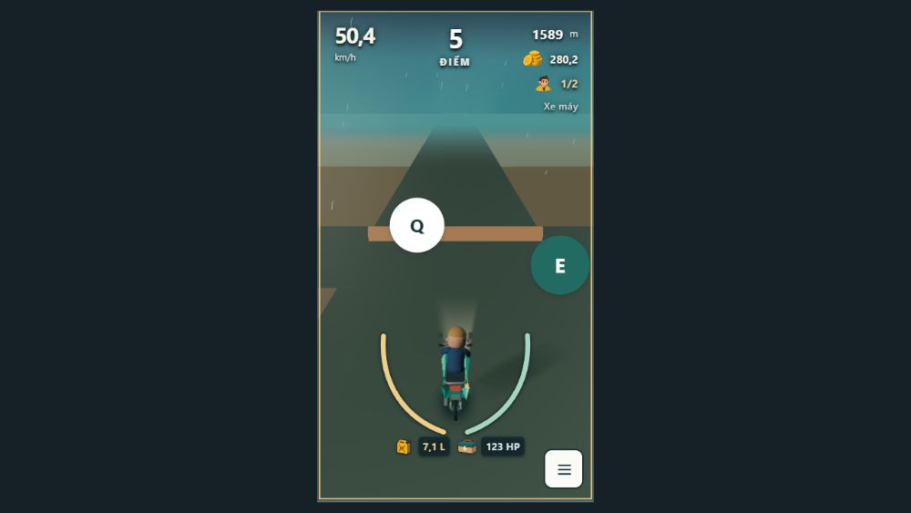
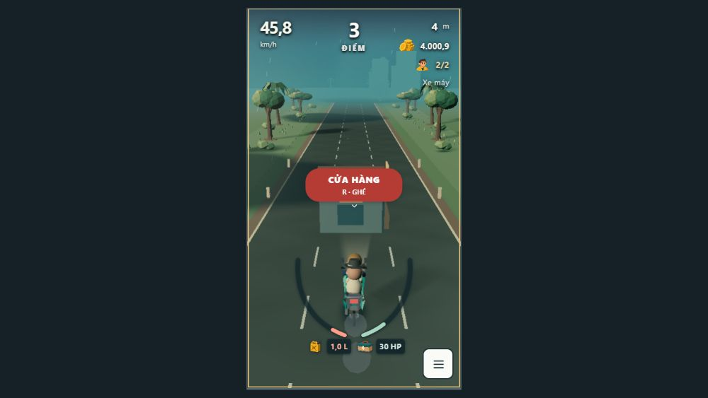

# Borderless tag feedback — 30/10/2026

Continuation of the existing UI feature after `97091ad`. This is a CSS-only product change in `src/ui-flat.css`; simulation, input acceptance, QTE windows and distance-based growth are unchanged.

- Removed borders from white fuel/repair badges and both unselected/selected Q/E circles.
- Removed the white border from the red CỬA HÀNG tag.
- A successfully selected Q/E tag becomes dark teal (`#216b62`) with white text and 8% extra scale. The other stays white. The previous double-ring selection is superseded. Enlargement provides an additional cue beyond color.

## Current browser audit / manual check

Codex in-app browser, seed 17. A separate temporary test tab was used to preserve the user's paused run. Screenshots below were captured and opened in this review; no old screenshot is used as evidence for the new style.

| Step | Observation | Health |
|---|---|---|
| 1. E choice, `blocked-window` | Real E input selected right. Computed E background `rgb(33,107,98)`, white text; Q background white. Both computed borders `0px`. | Pass; `01-selected-borderless-qte.png` |
| 2. Q choice, restarted fixture | Real Q input selected left; E stayed white. Both borders `0px`. | Pass; `02-q-selected.png` |
| 3. Supplies | Both white circular fuel/repair badges had computed border `0px`; actual pickup/coasting fixture continued. | Pass; `03-borderless-supplies.png` |
| 4. Shop | Red shop tag had computed border `0px`, retained its text and R prompt. | Pass; `04-borderless-shop.png` |

UI/UX **self-review**, based on these screenshots, real keyboard input and computed styles: the border/double-ring visual clutter is removed; selected direction has a clear filled state. This is not independent accessibility certification; screen reader and physical touch-device testing were not repeated for this cosmetic change.

Game-designer **self-review**: both choices were accepted in the existing fixture window. No timing, balance, spawn or mechanic adjustment was applied. These controlled checks do not establish overall fairness. No balance proposal is applied in this pass.

## Validation / handoff

Required local commands: `pnpm lint`, `pnpm typecheck`, `pnpm test --maxWorkers=2`, `pnpm build`; final results and output are in `docs/evidence/ui-borderless-2026-10-30/`. Environment: Windows PowerShell, bundled Node v24.22.1, pnpm 11.25.0. No new implementation-mirroring test was added for CSS declarations; the existing suite and browser interaction check cover the related behavior.

All four commands passed with exit 0. Tests: 74 files / 413 tests. Build retains the existing large Three.js chunk warning. Output copies are `lint.txt`, `typecheck.txt`, `tests.txt`, `build.txt` (trailing blank lines removed).

Human review pending; not merged. Commit/push and remote CI status are reported separately; previous PR creation remains unavailable due to GitHub integration 403.
