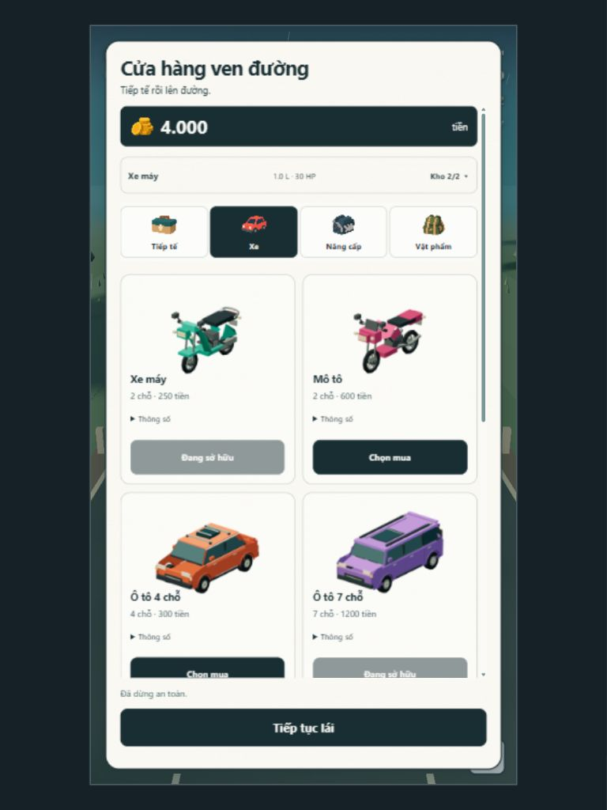
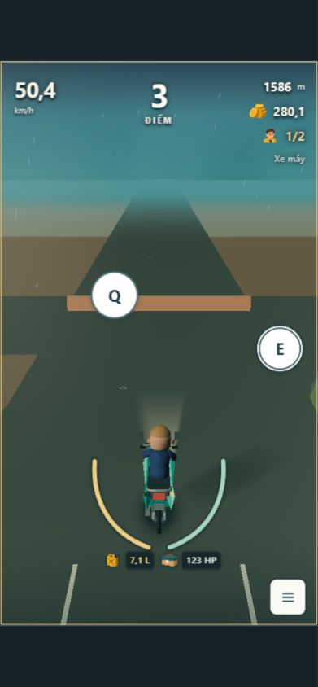
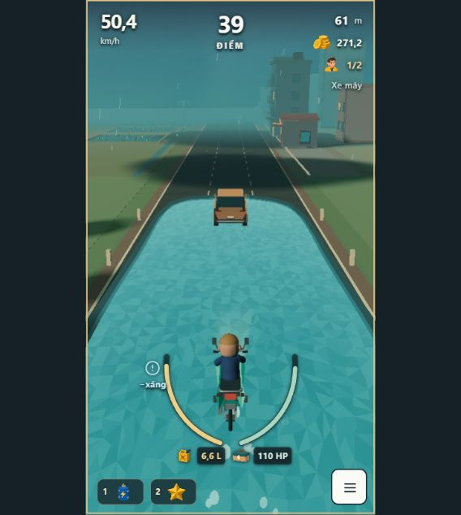
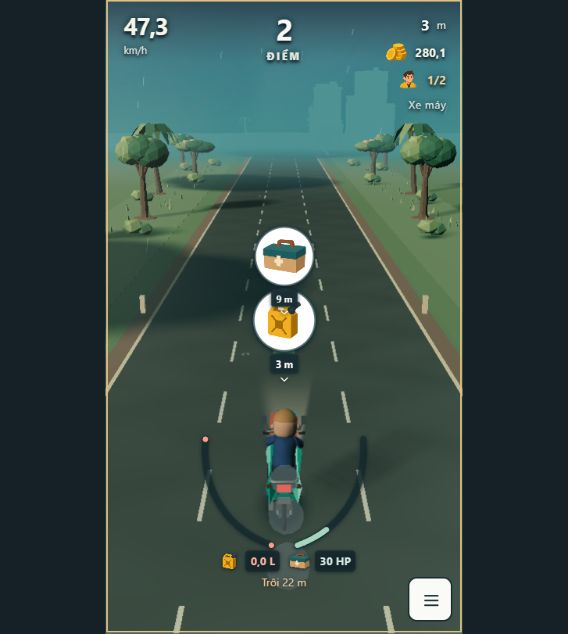
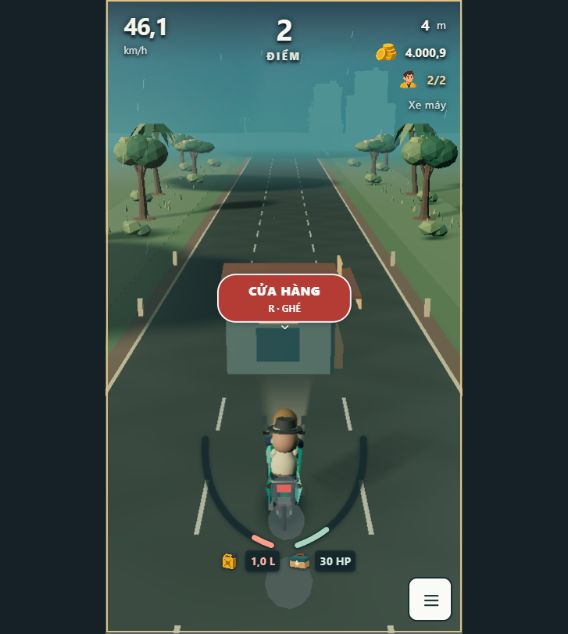

# UI follow-up — 30/10/2026

> Later cosmetic feedback supersedes the border/double-ring appearance described here: see `UI_BORDERLESS_REVIEW_2026-10-30.md`. Tags now have no borders; selected Q/E uses a teal fill and slight enlargement.

Continuation of `feature/ui-flat-mobile` after `43cc585`, on the previously owner-selected VFX base. Existing unrelated untracked files remain untouched. No model, simulation, physics, spawn, prices, damage, route windows or balance configuration changed.

## Changes

- Vehicle cards, garage and purchase confirmation show PNG thumbnails rendered from **each actual player model**, including its catalog paint. All eight families use `createVehicleArt(kind, 'player', 'near')`; no generated stand-in vehicle pictures are used for these thumbnails.
- A lazy module renders eight transparent 360×240 PNGs once using one temporary WebGL context. It frames each model's projected bounding box, caches only the image sources and disposes model resources/context. Shop re-renders reuse the cache; no permanent extra animation loop or scene is kept. Failed thumbnail rendering leaves the labelled transaction interface available.
- Confirmation resets its inner scroll position so the chosen model is visible instead of inheriting the catalog's previous scroll offset.
- Two fixed item slots move to the lower left edge, outside the forward driving corridor and beside the hamburger. Effect timers stay with the slots.
- Fuel/repair tags have larger, white, circular badges with colored illustrations. Shop has a longer red tag labelled **CỬA HÀNG**, with no bag icon.
- QTE presents only the two white circular **Q/E** tags. Selected direction has a double ring. Visible central copy, countdown and straight-ahead arrow are removed; semantic status remains available to assistive technology. Existing opening/closing and selection logic is unchanged.
- Supply/shop/QTE tags scale directly with distance: small far away, full size near the player. This presentation ramp is independent of acceleration/braking, so braking cannot shrink an approaching tag. It does not change warning ranges or decision timing.

## Validation

Windows PowerShell, Node v24.22.1, pnpm 11.25.0. All commands actually ran against the final source state:

| Gate | Command | Result |
|---|---|---|
| Lint | `pnpm lint` | Pass, exit 0 |
| Types | `pnpm typecheck` | Pass, exit 0 |
| Tests | `pnpm test --maxWorkers=2` | Pass, exit 0; 74 files / 413 tests |
| Build | `pnpm build` | Pass, exit 0; existing Three.js large-chunk warning remains |

Command output copies: `docs/evidence/ui-followup-2026-10-30/{lint,typecheck,tests,build}.txt` (trailing blank lines removed). Tests protect actual catalog/model selection, full framing including long vehicles, one-context caching/disposal, eight distinct image sources in shop DOM, correct purchase image, preserved transactions, supply tag structure, updated cue/UI wiring, monotonically growing tags and scale invariance when speed changes at the same distance. Existing gameplay tests remain enabled.

## Browser checks and screenshot audit

Codex in-app browser, seed 17, working feature revision. Fresh screenshots were captured and opened during this review. Browser connection required a reset after a temporary control failure; it recovered. CSS viewport sizes were measured, not inferred from requested outer dimensions.

| Step | Actual observation | Health / evidence |
|---|---|---|
| 1. Vehicle shop | All eight image elements loaded with natural width 360; individual models/colors were visible. Current-tab error log was empty at the check. | Pass; `01-vehicle-thumbnails.png`, `09-tablet-models.png`, `11-phone-models.png` |
| 2. Confirmation / buy | `shop-third`: car4 thumbnail visible; confirm disabled before discard choice. Selecting spare car7 then confirming reduced money 4000→3700, retained one passenger, kept garage 2/2 and equipped car4. | Pass; `10-tablet-confirm.png` and DOM observations. `02-confirm-model.png` is the earlier, superseded scroll issue |
| 3. QTE | `junction`: far circular tags visible. `blocked-window`: actual E input selected right; final DOM reported selected=true, scale≈0.893 and central text clipped with `inset(50%)`. The screenshot shows the selected double ring and no central copy/straight arrow. | Pass for these fixtures; `03-qte-far.png`, `12-final-qte-near.png`. `04-after-junction.png` is not accepted as near-tag evidence because that capture missed the window |
| 4. Shop tag | `shop`: longer red CỬA HÀNG tag, R prompt retained; no shop icon. | Pass; `06-shop-road-tag.png` |
| 5. Item dock | `items`: both slots at the lower left while the game was running. Observed dock top≈589/bottom≈621 against game bottom≈634 CSS px; central forward corridor remained clear. | Pass; `07-bottom-slots.png` |
| 6. Supply tags | `supplies`: both circular fuel/repair badges visible at different depths; normal coasting/pickup simulation continued. | Pass for this fixture; `08-round-supply-tags.png` |
| 7. Reflow | CSS 391×844 and 768×1024: card images contained, two columns retained, title/exit visible, content scrollable. | Pass; `09-tablet-models.png`, `10-tablet-confirm.png`, `11-phone-models.png` |

### Accepted views

## Self-review and limits

**UI/UX self-review:** based on the current browser interactions, screenshots, DOM measurements and tests, not an independent reviewer. P1 resolved: upper inventory dock obstructed forward scenery. P2 resolved: generic vehicle pictures did not distinguish the actual catalog, and a scrolled catalog could crop the purchase preview. Circular badges and larger near tags improve recognition while retaining side placement. Physical touch devices, screen reader behavior and long-session thumbnail performance have not been independently tested; no full touch driving controller is added.

**Game-designer self-review:** Q/E selection and purchase outcomes behaved correctly in controlled seed-17 fixtures. Tag scale is presentation-only; the full existing simulation suite passed. These observations do not establish fairness or overall natural-route balance. **ĐỀ XUẤT, chưa áp dụng:** compare several natural-route human runs for late recognition of far, small tags before changing any cue sizes or warning timing further; no balance adjustment was made here.

Human review: pending on the final revision. Merge: not performed. Commit/push/remote CI status is reported in the handoff; this document does not assert remote CI approval. Existing GitHub PR creation was blocked by integration 403.
