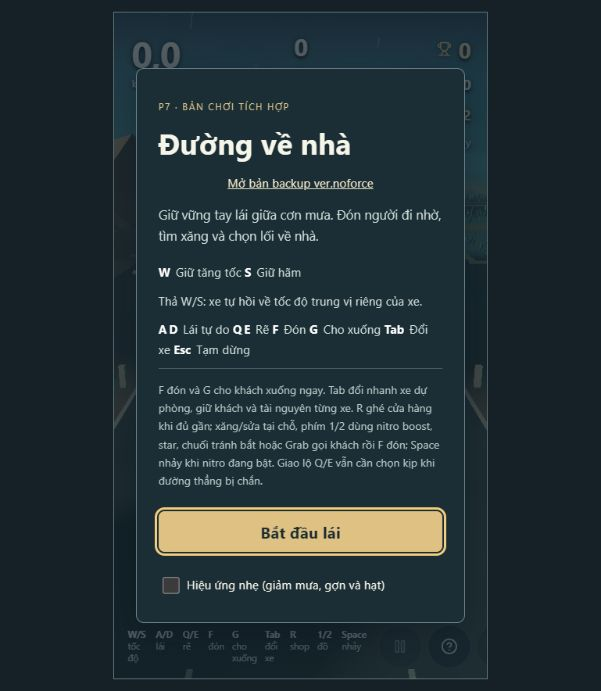
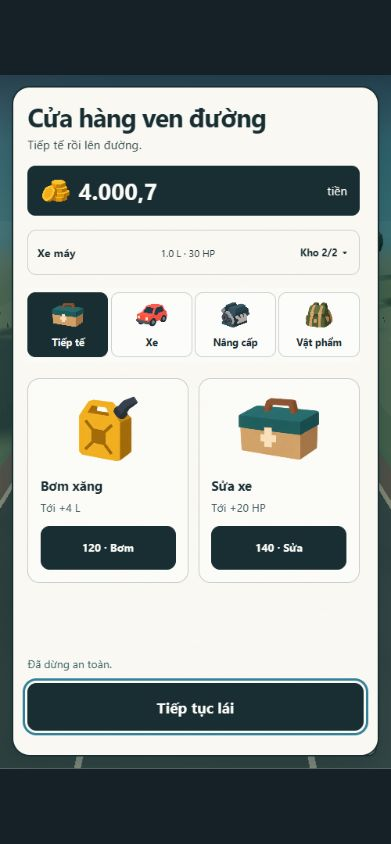
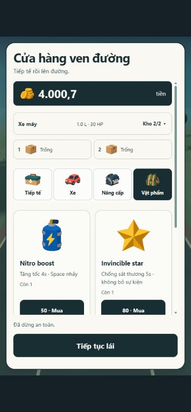
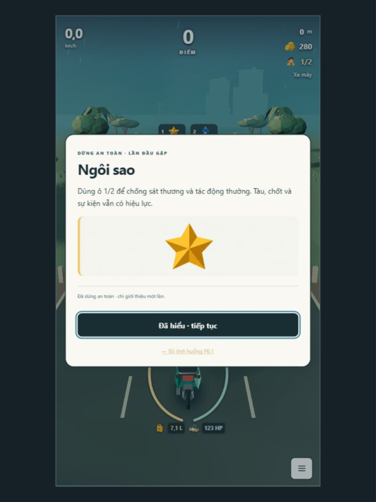
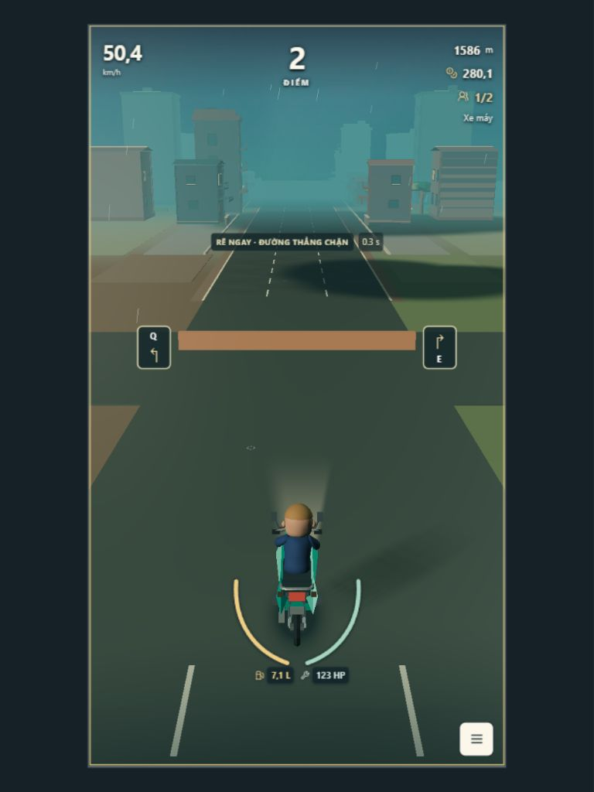
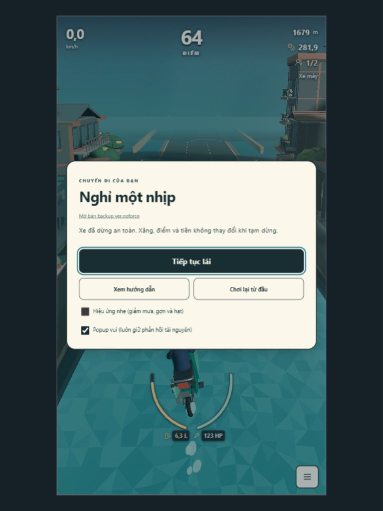
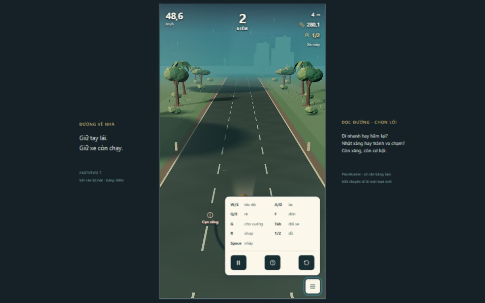
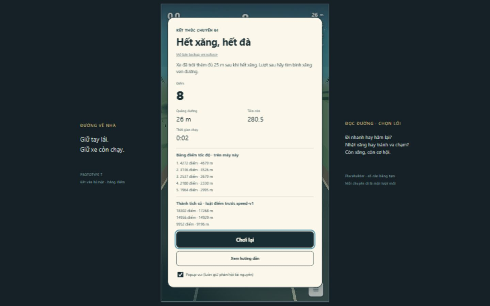

# UI redesign — 29/10/2026

## Scope and base

Feature branch: `feature/ui-flat-mobile`, based on `1680b5e`. The owner explicitly selected that VFX revision instead of `main` for this feature. `origin/main` was fetched and observed at `f289612`; it was not reset, merged or changed. Review this feature against `codex/player-dark-blue-jacket` to isolate UI changes from the preceding unmerged VFX work.

The inherited uncommitted trial was inspected and saved locally as `docs/evidence/ui-redesign-2026-10-29/inherited-ui-trial.patch`. Its scope was reevaluated against the new brief. Existing untracked `docs/evidence/p14-ui/` and `ui-pass-gates.json` are not evidence for this feature and are not included in its commit.

## Result

- Shop rebuilt as compact illustrated cards, four categories, a wallet, an expandable two-instance garage, fixed inventory slots, explicit third-vehicle discard and a persistent exit button. Detailed vehicle specifications remain behind “Thông số”. Services, prices, stock, transactions and upgrades still use existing simulation/config.
- Points occupy the central primary metric; metres move to the former points position. No cruise value on the driving HUD.
- Only fuel, repair and shop have spatial tags. Passenger pickup, train waiting, officer/banana response and impending cargo release use one compact essential-action cue. Q/E route decisions remain separate, driven by existing `junctionWindow` data.
- Bottom instructions and pause/Help/restart are inside a closed hamburger. Mouse enter/leave opens/closes it; tap/click toggles it; outside pointer input closes it. M and Escape provide keyboard access and return focus to the canvas. Modal focus trapping includes expandable summaries.
- Five discovery categories: passengers, wind, train, officers (police + militia), all remaining obstacles. Four item introductions: nitro, star, banana, Grab. Supplies/shop do not create additional discovery interruptions. State persists in `dvn.discovery.v2`, with migration of legacy entity cards into groups. No repeat on use/restart. Cards freeze simulation and defer during the route-decision cue.
- Owner feedback applied: rounded panels, colored **minimal flat-shaded** icons, near-white neutral paper surface with very faint texture. The rendered volumetric icons and yellow paper treatment were rejected and superseded. Functional menu/pause/arrows remain simple symbols.
- Shared HTML comparison entries are upgraded in place by `ui-shell.ts`; their source HTML and noforce simulation/config are unchanged. No scene/VFX changes.

## Automatic validation

Windows PowerShell; bundled Node `v24.22.1`, pnpm `11.25.0`; existing lockfile/dependencies, no dependency updates.

| Gate | Command | Result |
|---|---|---|
| Lint | `pnpm lint` | Pass, exit 0 |
| Types | `pnpm typecheck` | Pass, exit 0 |
| Tests | `pnpm test --maxWorkers=2` | Pass, exit 0; 73 files / 411 tests |
| Production | `pnpm build` | Pass, exit 0; existing large Three.js chunk warning remains |

Logs: `docs/evidence/ui-redesign-2026-10-29/{lint,typecheck,tests,build}.txt` (copies of local command logs, trailing blank lines removed; `.log` files are ignored by the repository). The first working run found obsolete presentation assertions and a 5-second simulation timeout while many CPU-heavy suites and lint ran concurrently. Expectations for deliberately removed UI were updated; simulation assertions/timeouts/rules were not relaxed. Limiting workers reran the entire suite successfully.

Meaningful new coverage includes category migration, independent item persistence, safe item introduction without consumption, no repeats on use/restart, mouse/touch menu event distinction, keyboard access, only three permitted supply tags, retained essential actions, fixed item slots, and explicit discard/cancel/atomic purchase of a third vehicle. Existing simulation suites still cover economy, collision, QTE and terminal events.

## Current-run browser checks and screenshot audit

Codex in-app browser, seed 17, current working feature revision. Screenshots were captured during this review and opened for inspection. CSS viewport dimensions were read from the page; browser zoom means requested outer viewport sizes differ from CSS pixels.

| Step | Scenario / observation | Health / evidence |
|---|---|---|
| 1. Start | Original instructions were long; new start exposes three input groups and a separate Help action. | Improved; `01-before-start.png`, `02-after-start.png` (early iteration) |
| 2. Phone shop | CSS 391×844; rounded cards, category navigation, active-vehicle summary, clear disabled state and persistent exit. Also inspected CSS 305×659: inner content scrolls, title/exit stay visible. | Functional; final near-white/flat-icon screenshots replace the earlier yellow/volumetric versions |
| 3. Services | In `shop-third`, fuel 1→5 L and money 4000→3880, then HP 30→50 and money 3880→3740 in the first service run. | Pass; DOM observations and service screenshots |
| 4. Third vehicle | `shop-third`: buy car4 only after selecting the spare car7 for discard. Money reduced by 300, occupants remained 2, active car4, garage remained 2/2. | Pass; DOM observations; explicit selection also covered by integration test |
| 5. Discovery | `items`: nitro and star introductions appear separately, with paused resources and a clear continue action. | Pass; tablet CSS 768×1024, `08-tablet-discovery.png` (earlier line-icon iteration); final illustrated card captured separately |
| 6. QTE/input | `blocked-window`: visible Q/E and timer; real E input changed status to “ĐÃ CHỌN PHẢI”. Continued beyond 1600 m; W and A held via browser input, followed by Esc pause. Camera/road continued through the turn. | Pass for this fixture; `09-qte-window.png`, `10-after-turn-paused.png`. The short timer is the deliberately late fixture, not a new hardcoded UI window |
| 7. Menu/result/restart | CSS 1440×900, `coast`: M opened instructions; run ended for fuel after coasting, result/leaderboard shown; “Chơi lại” reset metres/score. M→Escape returned focus to canvas in the restarted run. | Pass; `11-desktop-menu.png`, `12-desktop-result.png` |
| 8. Backup template | `ver.noforce.html?seed=17` opened with its original 200 money / 5.5 L / 70 HP profile and the shared UI shell. | Smoke pass; no assertion of full backup gameplay regression testing |

Accepted evidence below is from this review. Images 02–18 include intermediate designs; the active icon/paper result is **19–21**. The original generated volumetric atlas is retained only locally as a rejected iteration and is not shipped.

1. Start, before: too much instruction text; replaced by short input groups and optional Help.

2. Phone service shop, final: near-white rounded surface, two simple illustrated cards and a stable exit.

3. Phone item shop, final: colored flat-shaded items, prices, stock and fixed slots.

4. Tablet card, final: short explanation and one flat-shaded illustration; simulation paused. The captured card is the star introduction in the wind fixture.

5. Route QTE: visible branches and live deadline; actual E input selected right after this screenshot.

6. Turn and pause: continued beyond the junction, real W/A input then Esc pause.

7. Desktop menu and results: earlier surface iteration, same tested controls/result logic. Final surfaces/icons are shown in steps 2–4.

### UI/UX self-review

This is Codex self-review from actual browser interaction, saved screenshots, DOM observations and integration tests; no independent designer reviewed it.

- P1 resolved: long onboarding and repeated variant cards. Short grouped introductions pause the run; detailed Help remains optional.
- P1 resolved: unwanted obstacle labels compete with route choices. Spatial tags now contain supplies/shop only; critical train/officer/cargo/pickup action cues and route QTE remain distinct.
- P2 resolved: shop content could scroll the exit/title out of view. Shop content now scrolls independently, with a stable heading and continue button. Garage expands on demand.
- P2 resolved: visual mismatch after feedback. Final icons use broad flat color/shadow areas; paper is near-white, with warm yellow styling removed.
- Accessibility positives observed: 44px primary control targets, visible focus, explicit action labels, icon + text/value feedback, keyboard menu and modal navigation. Screenshot inspection does not establish WCAG compliance.
- Remaining verification: physical phone/tablet touch, screen reader, OS text scaling and long-session performance. Responsive viewports are not physical-device tests. This feature does not add a full touch driving controller; original WASD/QE gameplay input is preserved.

### Game-designer self-review

Observed: route choice remained available after tag removal; services/discard/occupants behaved correctly in fixture transactions; pause and discovery stopped simulation; coasting terminal/restart behaved as expected. Existing seeded simulation checks passed. These observations do not prove overall timing/fairness or natural-route balance across all vehicles.

**ĐỀ XUẤT, chưa áp dụng:** run a small human comparison across several natural-route seeds after the owner reviews the new HUD, focusing on whether removing traffic tags increases missed hazard recognition and whether the single essential-action cue is sufficient. If readability suffers, first adjust placement/shape/timing of cues within existing reaction windows, before proposing any balance/spawn changes. No economy, damage, spawn, physics or balance changes were applied here.

## Handoff

Review human: pending on final revision. Merge: not performed. PR/commit/CI status is reported separately after the final commit/push attempt. This report does not itself claim that a PR exists or that remote CI is green.
